BÁO CÁO THỰC HÀNH HỆ THỐNG RECSYS GỢI Ý VIỆC LÀM

Nguyễn Hoàng Hà
Mã số sinh viên 102230343
Báo cáo cá nhân
Ngày thực hiện 28 tháng 10 năm 2026

## Kết quả thực hành

Thực nghiệm đã chạy đủ chín thuật toán trên dữ liệu MEDAJob và thu 11 ảnh gợi ý thực từ website. Bản xuất website xác định đúng tài khoản user458 nhưng chưa có hồ sơ kỹ năng và rating. Vì vậy, kết quả Python cho tài khoản này chủ yếu là dự phòng Popularity, chưa có căn cứ kết luận mức độ phù hợp với sở thích cá nhân.

Phần cập nhật hồ sơ, tạo rating và đăng ít nhất 10 tin chưa thực hiện. Danh sách 10 tin thật và CSV đã được chuẩn bị để xác nhận; không thay yêu cầu đăng thành công bằng số dòng trong CSV. Báo cáo phản ánh trạng thái thực tế này.

## Nội dung

1 Giới thiệu

2 Chức năng Hồ sơ

3 Chức năng Nhà tuyển dụng

4 Chức năng Tìm việc

5 Chức năng Gợi ý việc làm

6 MEDAJob và đối sánh chín thuật toán

7 Tham khảo

## 1 Giới thiệu

Website RECSYS tại http://wandertour.ddns.net:8020 hỗ trợ quản lý hồ sơ, danh mục tuyển dụng, tìm việc và gợi ý. Bài thực hành khảo sát các chức năng này, sau đó lập trình các biến thể CBF, CF hành vi, Hybrid, User-KNN, Item-KNN, Popularity, SGD, ALS Explicit và ALS Implicit để đối sánh kết quả.

Đơn vị phân tích là cặp user–job. Báo cáo tách kết quả trên snapshot đầy đủ dùng đối sánh website khỏi mô hình train/test dùng đánh giá ngoại tuyến. Các bộ dữ liệu được giữ riêng và định danh bằng SHA256; không trộn dữ liệu từ các lần xuất.

| Bộ dữ liệu | User | Job | Rating | View | User test |
| --- | --- | --- | --- | --- | --- |
| provided_snapshot | 345 | 791 | 104 | 680 | 34 |
| website_before | 466 | 1168 | 169 | 0 | 11 |
| website_after_capture | 466 | 1189 | 211 | 0 | 14 |

provided_snapshot: snapshot 7b33ca0861b04b83.

website_before: snapshot 51408df1d5bcdeb8.

website_after_capture: snapshot f6582d5747ac1d61.

Dữ liệu gốc không chứa username của sinh viên. Hai bản xuất website đều chứa user458. Snapshot sau đợt thu ảnh có thêm 21 job và 42 rating so với bản trước; các thay đổi này không phải là tin/rating do phiên thực hành này ghi lên website. Chưa có ảnh và backend gắn cùng một snapshot bất biến.

## 2 Chức năng Hồ sơ

Đăng nhập xác nhận Nguyễn Hoàng Hà, username sv102230343, user ID458, vai trò employer. Hồ sơ ứng viên chưa tồn tại, danh sách kỹ năng rỗng và chưa có rating. Không tự điền kỹ năng, kinh nghiệm, địa điểm hoặc mức lương khi chưa có thông tin thật.

Chuẩn hóa dự kiến chỉ áp dụng cách trình bày kỹ năng sau khi có nội dung xác nhận, ví dụ tách từ khóa bằng dấu phẩy nhưng giữ cụm nhiều từ. Bước đổi mật khẩu cần người dùng tự xác nhận; không lưu thông tin xác thực trong tài liệu.

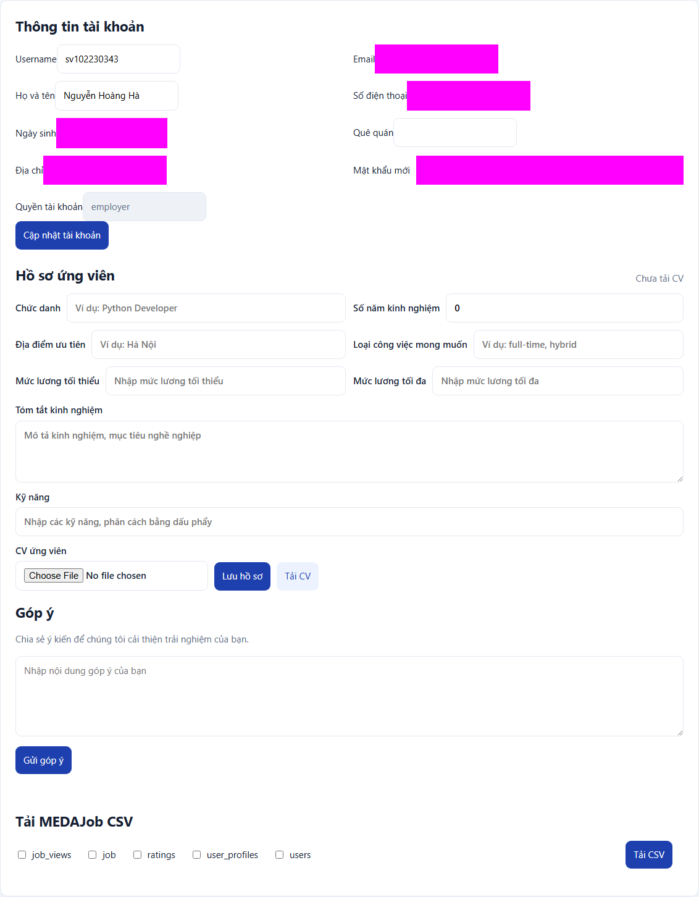
Hình 1. Hồ sơ ban đầu trống; các trường cá nhân không cần thiết đã che khi chụp

## 3 Chức năng Nhà tuyển dụng

Lần kiểm tra ban đầu cho thấy tài khoản chưa đăng tin nào. Không có tin riêng để rà soát đóng hết hạn, và không chỉnh sửa tin thuộc tài khoản khác.

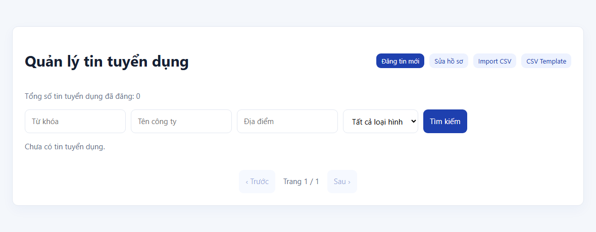
Hình 2. Danh sách tuyển dụng của tài khoản hiển thị 0 tin

Danh sách dự kiến gồm 10 tin được đối chiếu với 1189 tin trong snapshot sau thu ảnh. Kiểm tra ID/URL nguồn và tên công ty kết hợp độ gần tiêu đề không tìm thấy ứng viên trùng. Việc rà soát này có giới hạn theo thời điểm; cần làm mới ngay trước import.

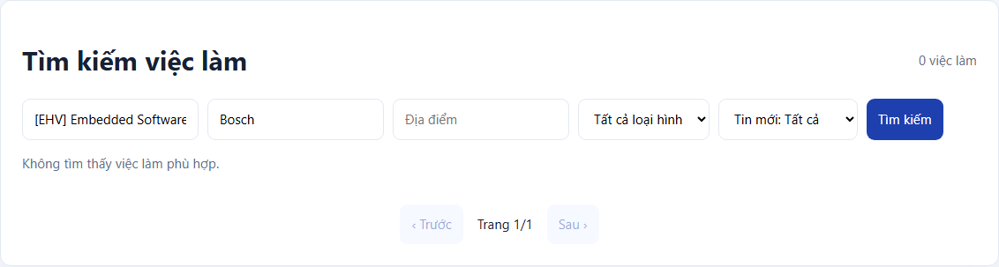
Hình 3. Ví dụ tìm tiêu đề J01 và công ty Bosch trả 0 mục; kiểm tra toàn bộ danh sách dùng snapshot export

Template có 19 cột nhưng dòng minh họa lệch cột do mảng kỹ năng chưa được CSV quoting đúng. File preview dùng quoting toàn bộ trường, đọc lại xác nhận mỗi dòng đủ 19 cột và job_skills là JSON array hợp lệ. Lương, hạn nộp và HR contact chưa được nguồn công bố được để trống, không tự đặt giá trị.

Chưa import nên số tin đăng thành công hiện là 0 và chưa có ID mới. Tin J03 có loại hợp đồng Intern ở nguồn; phải xác minh backend chấp nhận giá trị này, không tự đổi thành full-time. Không bấm ứng tuyển hoặc gửi hồ sơ cho nhà tuyển dụng thật.

### Danh sách 10 tin chờ xác nhận

| Mã | Vị trí | Nguồn | Địa điểm |
| --- | --- | --- | --- |
| J01 | [EHV] Embedded Software Engineer - Basic Software (BSW) | Bosch | Hồ Chí Minh |
| J02 | [EPC] Senior Embedded Software Engineer (with Joining Bonus) | Bosch | Hồ Chí Minh |
| J03 | [Internship] IT Support Intern | Bosch | Đồng Nai |
| J04 | [EDA] Intern for Embedded Software | Bosch | Hà Nội |
| J05 | [ETA] Fresher Embedded Software Engineer (C focused) | Bosch | Hồ Chí Minh |
| J06 | [ETA] Embedded Firmware Engineer | Bosch | Hồ Chí Minh |
| J07 | Fresher Test Engineer (Full-stack/Manual) | KMS | Hồ Chí Minh |
| J08 | Senior Full-stack Software Engineer (Node.js/ TypeScript) | KMS | Hồ Chí Minh |
| J09 | Full-stack Test Engineer (Manual, Automation), based in Da Nang | KMS | Đà Nẵng |
| J10 | Senior Test Engineer (AI-Augmented & Spec-Driven Testing) | KMS | Hồ Chí Minh |

Link kiểm chứng từng tin được ghi ở mục 7 và data/import/candidates.json. Các nguồn hết hạn như Bosch Full Stack .NET và Junior DevOps đã loại. Các tin dùng URL canonical mới sau chuyển hướng để hạn chế đăng trùng phiên bản cũ.

## 4 Chức năng Tìm việc

Thực hiện tìm kiếm từ khóa python, không lọc công ty, địa điểm hoặc loại hình. Website trả 53 việc và trang đầu có tối đa 15 mục. Ảnh được chụp sau khi trạng thái tìm kiếm kết thúc, lúc 19:44:57 28/10/2026. Đây là thao tác kiểm tra chức năng, chưa phải danh sách phù hợp cá nhân.

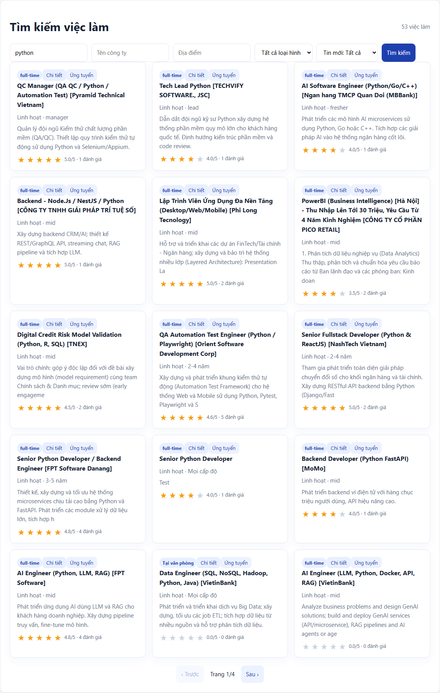
Hình 4. Kết quả tìm kiếm Python đã tải xong

### Lịch sử rating

Tài khoản chưa có rating. Việc tự đánh giá thay khi chưa biết mong muốn sẽ làm sai hồ sơ hành vi, vì vậy chưa tạo rating. Sau khi có kỹ năng, nghề và địa điểm thật, cần chọn các job đang mở và trình bảng job ID–rating–lý do trước khi ghi.

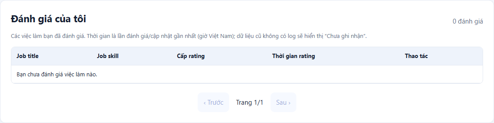
Hình 5. Lịch sử đánh giá của user458 có 0 mục

## 5 Chức năng Gợi ý việc làm

Đã chọn từng thuật toán với Cosine, địa điểm ưu tiên trống. CBF được thử thêm Jaccard và Pearson. Mỗi capture lưu HTTP status, thuật toán yêu cầu/trả về, nhãn trên giao diện, thời điểm, số kết quả và ID. Bản chụp thử gặp HTTP429 và stale UI không sử dụng trong báo cáo.

| Thuật toán | Độ đo | Kết quả | Ứng viên | Giờ Việt Nam |
| --- | --- | --- | --- | --- |
| popularity | cosine | 10 | 1157 | 14:39:01 |
| cf | cosine | 0 | 1157 | 14:39:57 |
| hybrid | cosine | 10 | 1157 | 14:40:39 |
| user_knn | cosine | 0 | 1157 | 14:41:50 |
| item_knn | cosine | 0 | 1157 | 14:42:22 |
| sgd | cosine | 0 | 1157 | 14:42:48 |
| als_explicit | cosine | 0 | 1157 | 14:43:18 |
| als_implicit | cosine | 0 | 1157 | 14:46:20 |
| cbf | cosine | 10 | 1157 | 14:46:55 |
| cbf | jaccard | 10 | 1157 | 14:47:32 |
| cbf | pearson | 10 | 1156 | 19:35:01 |

CBF, Hybrid và Popularity trả 10 mục; sáu phương pháp còn lại trả danh sách rỗng thành công với thông báo chưa đủ dữ liệu gợi ý. Không xem danh sách rỗng này là lỗi HTTP, và không suy ra backend sai. Một số ảnh baseline còn đang tải sao rating; chúng chứng minh danh sách xếp hạng, không chứng minh thao tác rating.

## 6 MEDAJob và đối sánh chín thuật toán

### 6 1 Tiền xử lý và cấu hình

Adapter nối users.id với user_profiles.user_id, giữ ID dạng chuỗi và toàn bộ catalog. Kỹ năng đọc được ở JSON array hoặc chuỗi phân cách, chuẩn hóa NFC/chữ thường, giữ nguyên cụm nhiều từ. Kiểm tra ID trùng, khóa ngoại, rating ngoài thang1–5 và thời lượng xem không hữu hạn; không tự bỏ bản ghi lỗi.

Rating explicit và view được tách. Rating từ4 trở lên tạo tín hiệu hành vi rating/5; view dương chỉ cho cặp chưa rating tạo trọng số0.25. Rating thấp chặn view cùng cặp. Job mở và chưa được user rating là tập ứng viên chung. Điểm bằng nhau được sắp ID tăng dần. Không clip dự đoán để tránh mất thứ hạng.

| Tham số | Giá trị |
| --- | --- |
| top_n | 10 |
| seed | 42 |
| similarity | cosine |
| positive_threshold | 4.0 |
| view_weight | 0.25 |
| hybrid_alpha | 0.55 |
| knn_k | 5 |
| popularity_prior | 5.0 |
| factors | 12 |
| sgd_epochs | 45 |
| sgd_lr | 0.012 |
| sgd_reg | 0.04 |
| als_explicit_epochs | 12 |
| als_explicit_reg | 0.4 |
| als_implicit_epochs | 10 |
| als_implicit_alpha | 16.0 |
| als_implicit_reg | 0.7 |

Điểm model-supported được xếp trước dự phòng Popularity; mỗi dòng ghi score_type, status và fallback. Đây là chính sách Python công khai, chưa biết website có sử dụng cùng chính sách hay không. Không dùng điểm của thuật toán khác nhau để so trực tiếp độ phù hợp.

### 6 2 CBF theo kỹ năng

Dùng cosine giữa vector kỹ năng nhị phân user và job. Jaccard dùng tỷ lệ giao/hợp; Pearson dùng vector đã trừ trung bình. Không có kỹ năng user thì trả prior Popularity có nhãn.

Python trả 10 mục cho user458 trong snapshot 51408df1d5bcdeb8. Bảng sau trích5 vị trí đầu; đầy đủ10 vị trí có trong recommendations.csv và notebook.

| Hạng | Job ID | Điểm | Loại kết quả |
| --- | --- | --- | --- |
| 1 | 838 | 4.4675 | prior fallback |
| 2 | 1865 | 4.4675 | prior fallback |
| 3 | 1884 | 4.4155 | prior fallback |
| 4 | 1899 | 4.4155 | prior fallback |
| 5 | 1901 | 4.4155 | prior fallback |

| K | n test | HR/Recall | NDCG | Coverage | Fallback |
| --- | --- | --- | --- | --- | --- |
| 5 | 11 | 0.0000 | 0.0000 | 0.0305 | 0.0000 |
| 10 | 11 | 0.0000 | 0.0000 | 0.0558 | 0.0000 |

Website: 10 mục, HTTP200, thời điểm 14:46:55 28/10/2026. Website vẫn trả điểm CBF khác 0 dù profile API rỗng. Chưa biết đặc trưng hoặc mặc định nội bộ backend, nên không gán chênh lệch này thành lỗi. Python chỉ dùng kỹ năng theo định nghĩa đã công bố.

#### Minh chứng website CBF theo kỹ năng

Hình 6. CBF theo kỹ năng với Cosine; ảnh thực của tài khoản sinh viên

### 6 3 CF theo hành vi

Tính cosine item–item trên tín hiệu hành vi tích cực, bỏ đường chéo; tổng có trọng số theo hành vi user được chia cho tổng tín hiệu tối thiểu1. Không có hỗ trợ đồng xuất hiện thì dùng prior.

Python trả 10 mục cho user458 trong snapshot 51408df1d5bcdeb8. Bảng sau trích5 vị trí đầu; đầy đủ10 vị trí có trong recommendations.csv và notebook.

| Hạng | Job ID | Điểm | Loại kết quả |
| --- | --- | --- | --- |
| 1 | 838 | 4.4675 | prior fallback |
| 2 | 1865 | 4.4675 | prior fallback |
| 3 | 1884 | 4.4155 | prior fallback |
| 4 | 1899 | 4.4155 | prior fallback |
| 5 | 1901 | 4.4155 | prior fallback |

| K | n test | HR/Recall | NDCG | Coverage | Fallback |
| --- | --- | --- | --- | --- | --- |
| 5 | 11 | 0.4545 | 0.2561 | 0.0262 | 0.0909 |
| 10 | 11 | 0.5455 | 0.2885 | 0.0393 | 0.0909 |

Website: 0 mục, HTTP200, thời điểm 14:39:57 28/10/2026. Tài khoản chưa có hành vi huấn luyện. Website không có gợi ý, Python trả dự phòng. Đây là khác biệt chính sách cold-start, không phải bằng chứng CF được tái tạo sai.

Hình 7. CF theo hành vi hiển thị chưa đủ dữ liệu gợi ý

### 6 4 Hybrid kết hợp

Trộn 0.55 lần CBF min-max và0.45 lần CF min-max theo user. Không trộn prior rating vào affinity; thiếu nhánh thì dùng nhánh còn lại với nhãn, thiếu cả hai dùng Popularity.

Python trả 10 mục cho user458 trong snapshot 51408df1d5bcdeb8. Bảng sau trích5 vị trí đầu; đầy đủ10 vị trí có trong recommendations.csv và notebook.

| Hạng | Job ID | Điểm | Loại kết quả |
| --- | --- | --- | --- |
| 1 | 838 | 4.4675 | prior fallback |
| 2 | 1865 | 4.4675 | prior fallback |
| 3 | 1884 | 4.4155 | prior fallback |
| 4 | 1899 | 4.4155 | prior fallback |
| 5 | 1901 | 4.4155 | prior fallback |

| K | n test | HR/Recall | NDCG | Coverage | Fallback |
| --- | --- | --- | --- | --- | --- |
| 5 | 11 | 0.1818 | 0.0846 | 0.0358 | 0.0000 |
| 10 | 11 | 0.2727 | 0.1120 | 0.0593 | 0.0000 |

Website: 10 mục, HTTP200, thời điểm 14:40:39 28/10/2026. User458 thiếu cả hai nhánh trong Python. Website trả10 mục khác, nhưng trọng số và đặc trưng backend chưa được chứng minh giống Python.

#### Minh chứng website Hybrid kết hợp

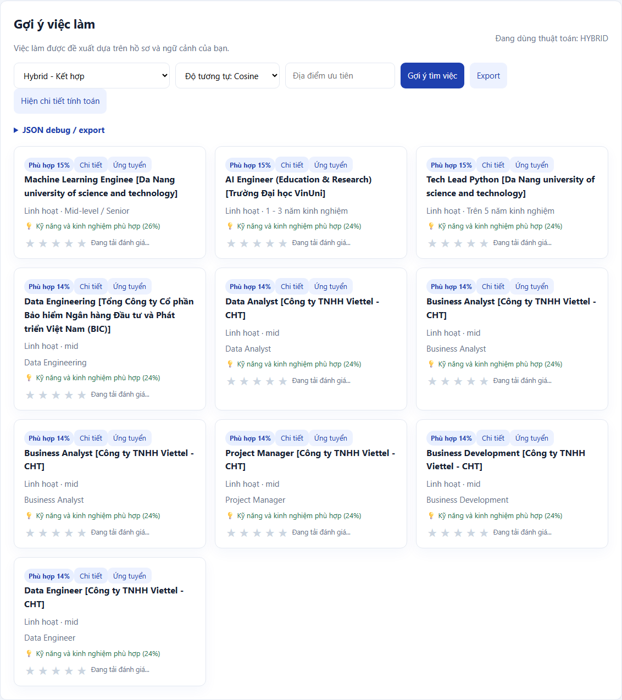
Hình 8. Hybrid kết hợp với Cosine; ảnh thực của tài khoản sinh viên

### 6 5 User KNN

Chọn tối đa5 láng giềng cosine trên vector rating. Dự đoán là trung bình rating có trọng số, mẫu số chỉ gồm láng giềng đã rating job đang xét. User không có láng giềng dùng prior.

Python trả 10 mục cho user458 trong snapshot 51408df1d5bcdeb8. Bảng sau trích5 vị trí đầu; đầy đủ10 vị trí có trong recommendations.csv và notebook.

| Hạng | Job ID | Điểm | Loại kết quả |
| --- | --- | --- | --- |
| 1 | 838 | 4.4675 | prior fallback |
| 2 | 1865 | 4.4675 | prior fallback |
| 3 | 1884 | 4.4155 | prior fallback |
| 4 | 1899 | 4.4155 | prior fallback |
| 5 | 1901 | 4.4155 | prior fallback |

| K | n test | HR/Recall | NDCG | Coverage | Fallback |
| --- | --- | --- | --- | --- | --- |
| 5 | 11 | 0.0909 | 0.0352 | 0.0157 | 0.0909 |
| 10 | 11 | 0.1818 | 0.0676 | 0.0253 | 0.0909 |

Rating positive-holdout: RMSE=0.8589, MAE=0.6998; tỷ lệ dự đoán test dùng fallback=0.1818.

Website: 0 mục, HTTP200, thời điểm 14:41:50 28/10/2026. Không có vector rating của user458 để tìm láng giềng có ý nghĩa. Kết quả fallback không thể diễn giải là cộng đồng có sở thích giống sinh viên.

Hình 9. User KNN hiển thị chưa đủ dữ liệu gợi ý

### 6 6 Item KNN

Chọn tối đa5 job gần nhất theo cosine cột rating. Weighted mean chỉ dùng rating đã quan sát của user trên các job láng giềng; không coi missing là rating0.

Python trả 10 mục cho user458 trong snapshot 51408df1d5bcdeb8. Bảng sau trích5 vị trí đầu; đầy đủ10 vị trí có trong recommendations.csv và notebook.

| Hạng | Job ID | Điểm | Loại kết quả |
| --- | --- | --- | --- |
| 1 | 838 | 4.4675 | prior fallback |
| 2 | 1865 | 4.4675 | prior fallback |
| 3 | 1884 | 4.4155 | prior fallback |
| 4 | 1899 | 4.4155 | prior fallback |
| 5 | 1901 | 4.4155 | prior fallback |

| K | n test | HR/Recall | NDCG | Coverage | Fallback |
| --- | --- | --- | --- | --- | --- |
| 5 | 11 | 0.2727 | 0.1834 | 0.0227 | 0.3091 |
| 10 | 11 | 0.7273 | 0.3260 | 0.0279 | 0.4364 |

Rating positive-holdout: RMSE=0.9101, MAE=0.7156; tỷ lệ dự đoán test dùng fallback=0.3636.

Website: 0 mục, HTTP200, thời điểm 14:42:22 28/10/2026. User458 chưa có item đã rating để lan truyền sở thích. Tỷ lệ fallback trong holdout cần đọc cùng chỉ số xếp hạng, vì một phần độ chính xác đến từ prior.

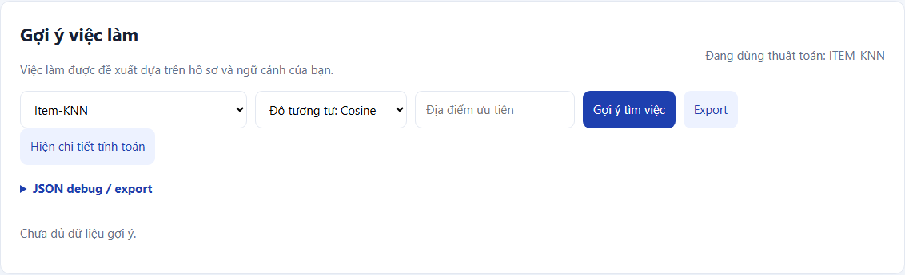
Hình 10. Item KNN hiển thị chưa đủ dữ liệu gợi ý

### 6 7 Popularity

Điểm là trung bình Bayes: tổng rating cộng5 lần global mean, chia cho số rating cộng5. Đây là baseline theo rating, không phải đếm lượt xem.

Python trả 10 mục cho user458 trong snapshot 51408df1d5bcdeb8. Bảng sau trích5 vị trí đầu; đầy đủ10 vị trí có trong recommendations.csv và notebook.

| Hạng | Job ID | Điểm | Loại kết quả |
| --- | --- | --- | --- |
| 1 | 838 | 4.4675 | Bayes baseline |
| 2 | 1865 | 4.4675 | Bayes baseline |
| 3 | 1884 | 4.4155 | Bayes baseline |
| 4 | 1899 | 4.4155 | Bayes baseline |
| 5 | 1901 | 4.4155 | Bayes baseline |

| K | n test | HR/Recall | NDCG | Coverage | Fallback |
| --- | --- | --- | --- | --- | --- |
| 5 | 11 | 0.1818 | 0.0925 | 0.0096 | 0.0000 |
| 10 | 11 | 0.4545 | 0.1836 | 0.0157 | 0.0000 |

Rating positive-holdout: RMSE=0.4573, MAE=0.3953; tỷ lệ dự đoán test dùng fallback=0.0000.

Website: 10 mục, HTTP200, thời điểm 14:39:01 28/10/2026. Website trả điểm0.1 và ưu tiên các ID mới trong lần chụp; Python dùng trung bình Bayes. Không có căn cứ giả định hai nhãn Popularity có cùng định nghĩa.

#### Minh chứng website Popularity

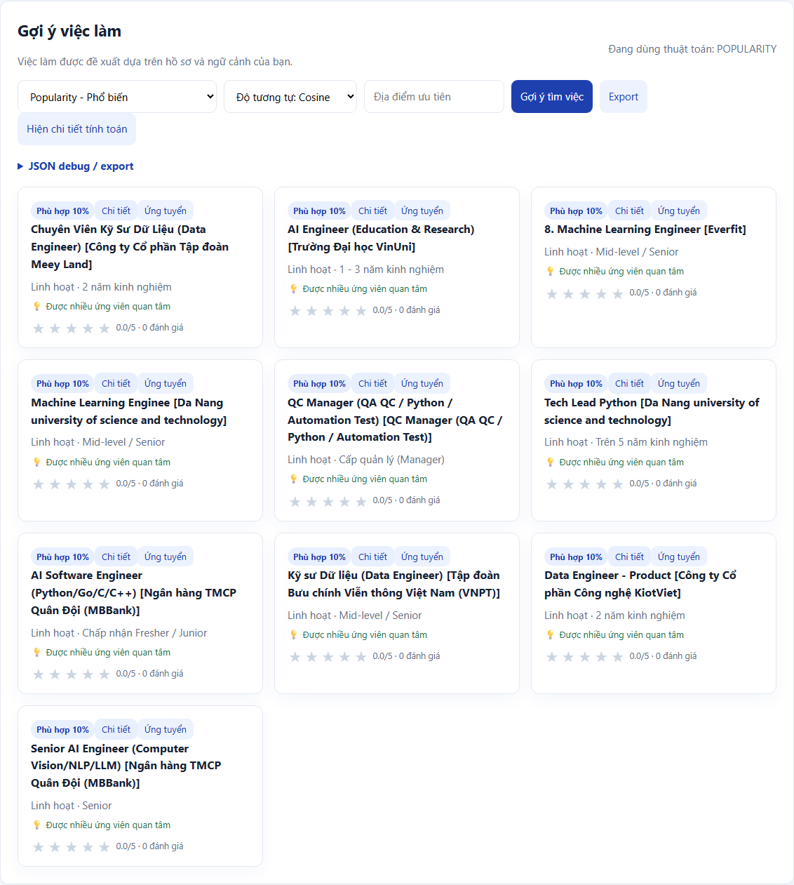
Hình 11. Popularity với Cosine; ảnh thực của tài khoản sinh viên

### 6 8 Model based CF SGD

Dự đoán gồm global mean, bias user, bias item và tích vô hướng hai vector nhân tố. Học45 epoch với12 nhân tố, learning rate0.012, regularization0.04 trên rating quan sát.

Python trả 10 mục cho user458 trong snapshot 51408df1d5bcdeb8. Bảng sau trích5 vị trí đầu; đầy đủ10 vị trí có trong recommendations.csv và notebook.

| Hạng | Job ID | Điểm | Loại kết quả |
| --- | --- | --- | --- |
| 1 | 838 | 4.4675 | prior fallback |
| 2 | 1865 | 4.4675 | prior fallback |
| 3 | 1884 | 4.4155 | prior fallback |
| 4 | 1899 | 4.4155 | prior fallback |
| 5 | 1901 | 4.4155 | prior fallback |

| K | n test | HR/Recall | NDCG | Coverage | Fallback |
| --- | --- | --- | --- | --- | --- |
| 5 | 11 | 0.0909 | 0.0392 | 0.0140 | 0.0000 |
| 10 | 11 | 0.1818 | 0.0678 | 0.0244 | 0.0000 |

Rating positive-holdout: RMSE=0.6273, MAE=0.5229; tỷ lệ dự đoán test dùng fallback=0.0000.

Website: 0 mục, HTTP200, thời điểm 14:42:48 28/10/2026. Không xếp hạng bằng vector ngẫu nhiên của user/job chưa học. User458 không có rating nên tất cả kết quả là prior có nhãn. Sai số train không phải sai số test.

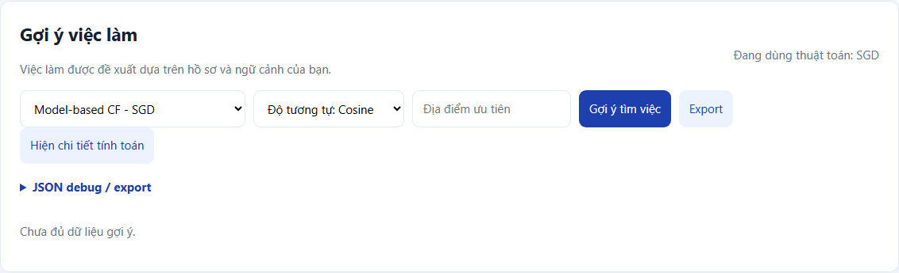
Hình 12. Model based CF SGD hiển thị chưa đủ dữ liệu gợi ý

### 6 9 ALS Explicit

Trừ global mean khỏi rating rồi luân phiên giải ridge cho user và item trên các ô quan sát. Dùng12 nhân tố,12 vòng, regularization0.4; cộng lại mean khi dự đoán.

Python trả 10 mục cho user458 trong snapshot 51408df1d5bcdeb8. Bảng sau trích5 vị trí đầu; đầy đủ10 vị trí có trong recommendations.csv và notebook.

| Hạng | Job ID | Điểm | Loại kết quả |
| --- | --- | --- | --- |
| 1 | 838 | 4.4675 | prior fallback |
| 2 | 1865 | 4.4675 | prior fallback |
| 3 | 1884 | 4.4155 | prior fallback |
| 4 | 1899 | 4.4155 | prior fallback |
| 5 | 1901 | 4.4155 | prior fallback |

| K | n test | HR/Recall | NDCG | Coverage | Fallback |
| --- | --- | --- | --- | --- | --- |
| 5 | 11 | 0.1818 | 0.0743 | 0.0323 | 0.0000 |
| 10 | 11 | 0.3636 | 0.1320 | 0.0436 | 0.0000 |

Rating positive-holdout: RMSE=0.5630, MAE=0.4629; tỷ lệ dự đoán test dùng fallback=0.0000.

Website: 0 mục, HTTP200, thời điểm 14:43:18 28/10/2026. Không đưa ô thiếu vào loss explicit. User chưa có rating dùng prior. RMSE/MAE chỉ đọc trên holdout positive, không so với affinity implicit.

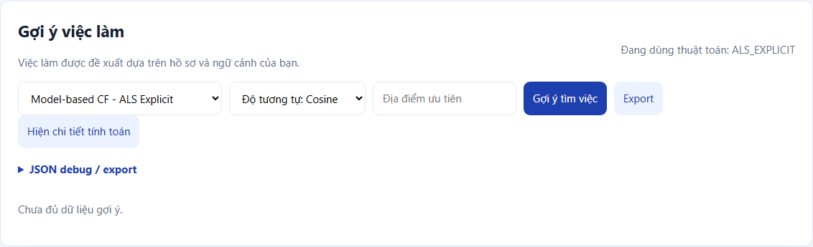
Hình 13. ALS Explicit hiển thị chưa đủ dữ liệu gợi ý

### 6 10 ALS Implicit

Preference bằng1 khi B dương; confidence bằng1+16B. Luân phiên giải weighted least squares trên preference,12 nhân tố,10 vòng, regularization0.7.

Python trả 10 mục cho user458 trong snapshot 51408df1d5bcdeb8. Bảng sau trích5 vị trí đầu; đầy đủ10 vị trí có trong recommendations.csv và notebook.

| Hạng | Job ID | Điểm | Loại kết quả |
| --- | --- | --- | --- |
| 1 | 838 | 4.4675 | prior fallback |
| 2 | 1865 | 4.4675 | prior fallback |
| 3 | 1884 | 4.4155 | prior fallback |
| 4 | 1899 | 4.4155 | prior fallback |
| 5 | 1901 | 4.4155 | prior fallback |

| K | n test | HR/Recall | NDCG | Coverage | Fallback |
| --- | --- | --- | --- | --- | --- |
| 5 | 11 | 0.3636 | 0.3182 | 0.0323 | 0.0000 |
| 10 | 11 | 0.5455 | 0.3742 | 0.0489 | 0.0000 |

Website: 0 mục, HTTP200, thời điểm 14:46:20 28/10/2026. Mô hình phân biệt preference với confidence theo Hu và cộng sự [2]. Rating thấp không tạo thích. Điểm là affinity nên không báo RMSE như rating; user458 chưa có tín hiệu dương dùng prior.

Hình 14. ALS Implicit hiển thị chưa đủ dữ liệu gợi ý

### 6 11 Thiết kế đánh giá và tổng hợp

Không có thời gian rating đáng tin cậy, nên dùng positive leave-one-out ngẫu nhiên với seed42. User có ít nhất3 rating và có một job mở rating≥4 còn hỗ trợ train được đưa vào test. Loại toàn bộ rating và view của chính cặp test khỏi train; học lại các ma trận, độ tương tự và prior trên train.

HitRate là tỷ lệ user có hit trong Top-K; Recall là số relevant được tìm/số relevant test. Mỗi user có một item test nên HR=Recall. NDCG giảm trọng số theo log2 của hạng. Coverage tính trên catalog mở; fallback_fraction tính trên các dòng gợi ý trả về. RMSE/MAE chỉ tính cho dự đoán rating và chỉ đại diện holdout tích cực.

Dữ liệu test nhỏ và không đại diện toàn bộ466 user. Chưa có repeated split, khoảng tin cậy hoặc đánh giá online. Không dùng kết quả này để khẳng định thuật toán tốt nhất cho mọi hồ sơ.

#### Kết quả K10 provided snapshot

| Thuật toán | n | HR/Recall | NDCG | Coverage | Fallback |
| --- | --- | --- | --- | --- | --- |
| cbf | 34 | 0.1765 | 0.1098 | 0.1063 | 0.0000 |
| cf | 34 | 0.3824 | 0.1809 | 0.0494 | 0.0000 |
| hybrid | 34 | 0.2941 | 0.1371 | 0.0810 | 0.0000 |
| user_knn | 34 | 0.3824 | 0.3192 | 0.0532 | 0.8676 |
| item_knn | 34 | 0.3824 | 0.3192 | 0.0532 | 0.8676 |
| popularity | 34 | 0.1176 | 0.0426 | 0.0152 | 0.0000 |
| sgd | 34 | 0.1176 | 0.0364 | 0.0266 | 0.0000 |
| als_explicit | 34 | 0.2647 | 0.1675 | 0.0595 | 0.0000 |
| als_implicit | 34 | 0.0000 | 0.0000 | 0.0620 | 0.0000 |

#### Kết quả K10 website before

| Thuật toán | n | HR/Recall | NDCG | Coverage | Fallback |
| --- | --- | --- | --- | --- | --- |
| cbf | 11 | 0.0000 | 0.0000 | 0.0558 | 0.0000 |
| cf | 11 | 0.5455 | 0.2885 | 0.0393 | 0.0909 |
| hybrid | 11 | 0.2727 | 0.1120 | 0.0593 | 0.0000 |
| user_knn | 11 | 0.1818 | 0.0676 | 0.0253 | 0.0909 |
| item_knn | 11 | 0.7273 | 0.3260 | 0.0279 | 0.4364 |
| popularity | 11 | 0.4545 | 0.1836 | 0.0157 | 0.0000 |
| sgd | 11 | 0.1818 | 0.0678 | 0.0244 | 0.0000 |
| als_explicit | 11 | 0.3636 | 0.1320 | 0.0436 | 0.0000 |
| als_implicit | 11 | 0.5455 | 0.3742 | 0.0489 | 0.0000 |

#### Kết quả K10 website after capture

| Thuật toán | n | HR/Recall | NDCG | Coverage | Fallback |
| --- | --- | --- | --- | --- | --- |
| cbf | 14 | 0.0000 | 0.0000 | 0.0709 | 0.0000 |
| cf | 14 | 0.4286 | 0.2267 | 0.0381 | 0.2857 |
| hybrid | 14 | 0.2143 | 0.0848 | 0.0735 | 0.0000 |
| user_knn | 14 | 0.2143 | 0.0807 | 0.0311 | 0.1786 |
| item_knn | 14 | 0.5714 | 0.2405 | 0.0320 | 0.4714 |
| popularity | 14 | 0.2857 | 0.1175 | 0.0156 | 0.0000 |
| sgd | 14 | 0.0714 | 0.0254 | 0.0285 | 0.0000 |
| als_explicit | 14 | 0.2857 | 0.1586 | 0.0415 | 0.0000 |
| als_implicit | 14 | 0.4286 | 0.2196 | 0.0467 | 0.0000 |

#### Biểu đồ đánh giá ngoại tuyến

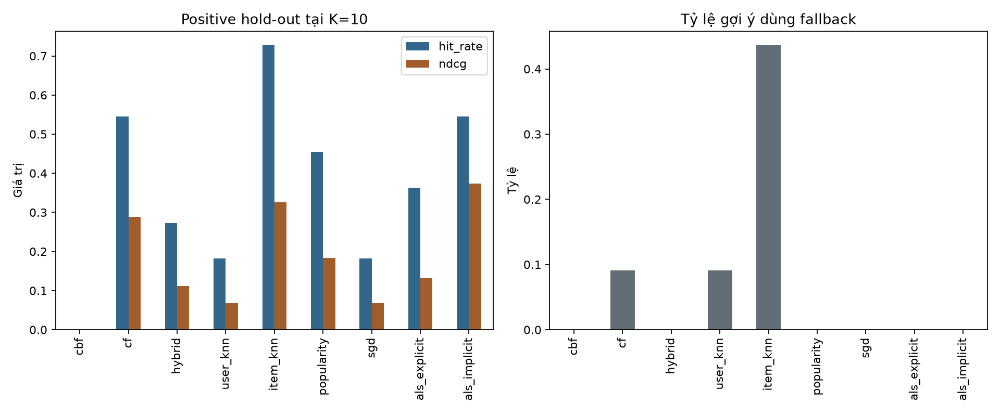
Hình 15. Metrics K10 và tỷ lệ dự phòng trên 11 user test của snapshot website trước thu ảnh

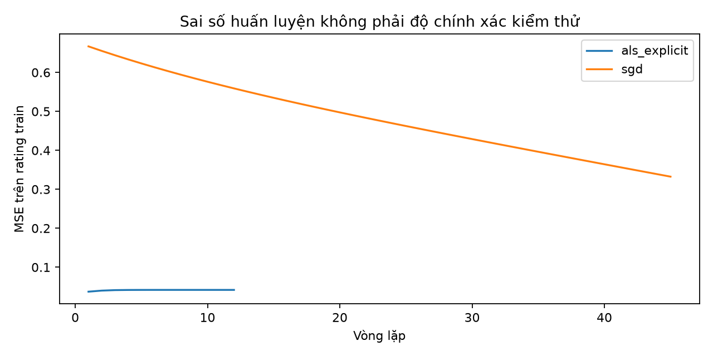
Hình 16. MSE trên tập train của SGD và ALS Explicit; không phải độ chính xác kiểm thử

### 6 12 Đối sánh theo job ID

So sánh chỉ dùng ID, không đồng nhất title hoặc score giữa hai hệ thống. Giao nhau là số ID chung; Jaccard là giao/hợp. Overlap@10 chỉ tính khi cả hai bên đủ10. Chênh lệch hạng chỉ tính trên ID chung. HTTP lỗi/thiếu capture không được thay bằng danh sách rỗng. Với danh sách rỗng thành công, Jaccard=0 là tính chất tập hợp, không phải điểm đánh giá chất lượng backend.

| Thuật toán | Web | Python | Giao | Jaccard | Overlap10 |
| --- | --- | --- | --- | --- | --- |
| cbf | 10 | 10 | 0 | 0.0000 | 0.0000 |
| cf | 0 | 10 | 0 | 0.0000 | N/A |
| hybrid | 10 | 10 | 0 | 0.0000 | 0.0000 |
| user_knn | 0 | 10 | 0 | 0.0000 | N/A |
| item_knn | 0 | 10 | 0 | 0.0000 | N/A |
| popularity | 10 | 10 | 0 | 0.0000 | 0.0000 |
| sgd | 0 | 10 | 0 | 0.0000 | N/A |
| als_explicit | 0 | 10 | 0 | 0.0000 | N/A |
| als_implicit | 0 | 10 | 0 | 0.0000 | N/A |

Không có ID chung trong Top10 của đối sánh baseline này nên chênh lệch hạng trên giao là N/A. Các tập ứng viên không được chứng minh giống nhau: website báo1157 ứng viên trong các ảnh đầu, trong khi CSV trước thu ảnh có1146 job mở. Diagnostics chỉ chứa50 dòng mẫu, không đủ tái tạo tập ứng viên. Chênh lệch không chứng minh backend sai.

CBF Cosine và Jaccard cho cùng danh sách website trong lần chụp đầu; Pearson được thu sau khi khôi phục phiên và dữ liệu đã thay đổi. Python của user không có skill nên cả ba độ đo đều rơi về cùng prior. Pearson có thể âm và không phải xác suất; website hiển thị phần trăm âm không nên hiểu là xác suất phù hợp âm.

#### Minh chứng CBF Jaccard

Thời điểm 14:47:32 28/10/2026; giữ trường hợp hồ sơ trống, không suy ra thay đổi sở thích.

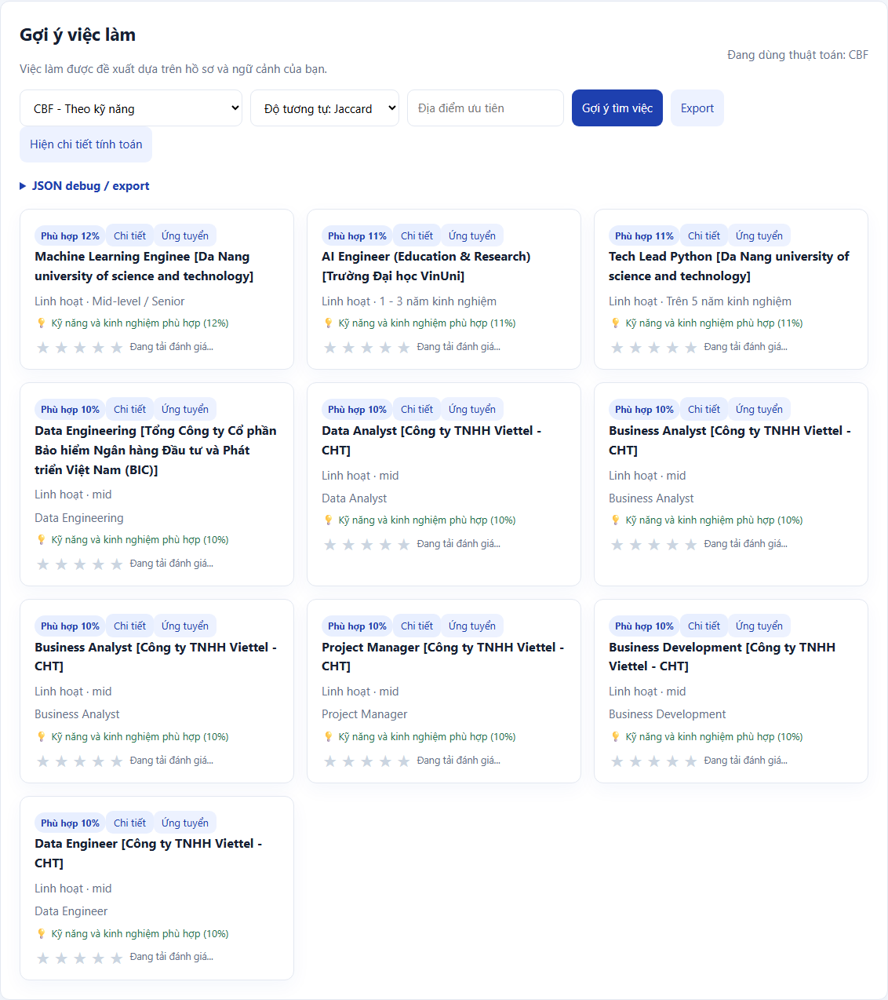
Hình 17. CBF Jaccard với tài khoản chưa có hồ sơ kỹ năng

#### Minh chứng CBF Pearson

Thời điểm 19:35:01 28/10/2026; giữ trường hợp hồ sơ trống, không suy ra thay đổi sở thích.

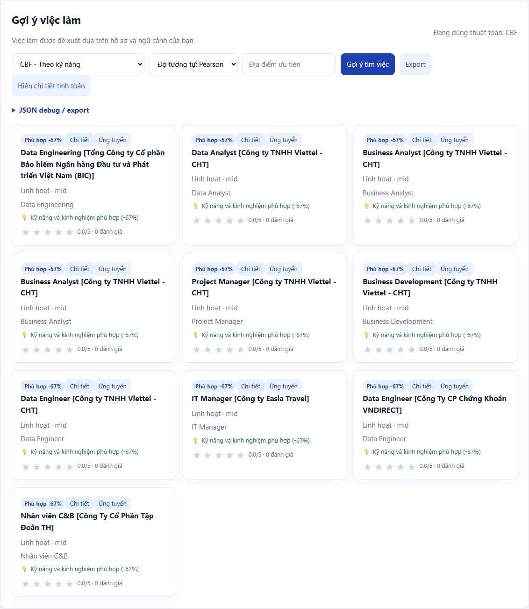
Hình 18. CBF Pearson với tài khoản chưa có hồ sơ kỹ năng

### 6 13 Kiểm thử và phần còn thiếu

Bộ kiểm thử kiểm tra parsing kỹ năng, CSV Unicode/dấu phẩy, ID, khóa ngoại, thang rating, thời lượng xem, cold-start, hết ứng viên, đồng điểm, tái lập, mask, tách holdout/view và phân biệt capture lỗi với danh sách rỗng thành công. Notebook đã thực thi14 cell mã từ kernel mới, không có cell lỗi.

Đã sao lưu notebook trước chỉnh sửa và giữ nguyên dữ liệu gốc. Source dùng chung giữa tests, CLI và notebook để tránh ba bản cài đặt lệch nhau. Các file CSV/ảnh được gắn hash trong manifest để kiểm tra tính toàn vẹn.

| Việc còn thiếu | Điều kiện hoàn tất |
| --- | --- |
| Hồ sơ và rating | Thông tin kỹ năng, nghề, địa điểm thật; duyệt bảng nội dung trước ghi |
| Ít nhất10 tin đã đăng | Duyệt J01–J10; kiểm tra lại nguồn/trùng; import và xác minh ID thực tế |
| Snapshot hậu cập nhật | Chỉ thu sau khi các thay đổi được duyệt và thành công |
| Đổi mật khẩu | Người dùng tự thực hiện xác nhận cuối |
| Kiểm tra bố cục Word | Render bằng môi trường hỗ trợ và kiểm tra từng trang; hiện chưa VERIFIED |

## 7 Tham khảo

[1] Đề thực hành LabDSS WebsiteRECSYS do giảng viên cung cấp; website http://wandertour.ddns.net:8020, truy cập28/10/2026. File đề được giữ nguyên và không đưa vào gói chia sẻ vì chứa ví dụ thông tin đăng nhập.

[2] Hu, Y.; Koren, Y.; Volinsky, C. (2008). Collaborative Filtering for Implicit Feedback Datasets. https://yifanhu.net/PUB/cf.pdf. Tham khảo phân biệt preference/confidence; quy tắc chuyển rating/view của thực nghiệm được công bố riêng ở mục6.

[3] Koren, Y.; Bell, R.; Volinsky, C. (2009). Matrix Factorization Techniques for Recommender Systems. Computer42(8),30–37. https://doi.org/10.1109/MC.2009.263. Tham khảo họ mô hình nhân tố; không khẳng định khớp backend website.

Nguồn tuyển dụng được diễn giải ngắn, không sao chép toàn bộ mô tả. Ngày xác minh28/10/2026; trạng thái có thể thay đổi. Từng tin phải được mở lại ngay trước import.

[J01] Bosch Global Software Technologies. [EHV] Embedded Software Engineer - Basic Software (BSW). https://jobs.smartrecruiters.com/BoschGroup/744000156236004--ehv-embedded-software-engineer-basic-software-bsw-

[J02] Bosch Global Software Technologies. [EPC] Senior Embedded Software Engineer (with Joining Bonus). https://jobs.smartrecruiters.com/BoschGroup/744000156705079--epc-senior-embedded-software-engineer-with-joining-bonus-

[J03] Bosch Vietnam. [Internship] IT Support Intern. https://jobs.smartrecruiters.com/BoschGroup/744000143439069--internship-it-support-intern

[J04] Bosch Global Software Technologies. [EDA] Intern for Embedded Software. https://jobs.smartrecruiters.com/BoschGroup/744000143758952--eda-intern-for-embedded-software

[J05] Bosch Global Software Technologies. [ETA] Fresher Embedded Software Engineer (C focused). https://jobs.smartrecruiters.com/BoschGroup/744000154052649--eta-fresher-embedded-software-engineer-c-focused-

[J06] Bosch Global Software Technologies. [ETA] Embedded Firmware Engineer. https://jobs.smartrecruiters.com/BoschGroup/744000157717649--eta-embedded-firmware-engineer

[J07] KMS Technology. Fresher Test Engineer (Full-stack/Manual). https://careers.kms-technology.com/job/fresher-test-engineer-full-stack-manual-744000155975597/

[J08] KMS Technology. Senior Full-stack Software Engineer (Node.js/ TypeScript). https://careers.kms-technology.com/job/senior-full-stack-software-engineer-node-js-typescript-744000152103869/

[J09] KMS Technology. Full-stack Test Engineer (Manual, Automation), based in Da Nang. https://careers.kms-technology.com/job/full-stack-test-engineer-manual-automation-based-in-da-nang-744000156705539/

[J10] KMS Technology. Senior Test Engineer (AI-Augmented & Spec-Driven Testing). https://careers.kms-technology.com/job/senior-test-engineer-ai-augmented-spec-driven-testing-744000158042229/

Căn cứ tái lập: source job_recsys, configs/experiment.json, outputs/notebook và data/website/verified_baseline trong gói bàn giao. Những file này lưu cấu hình và kết quả cụ thể đã dùng trong báo cáo.
