# HỆ THỐNG RECSYS GỢI Ý VIỆC LÀM

**Báo cáo thực hành Hệ hỗ trợ ra quyết định – Website RECSYS và bộ dữ liệu MEDAJob**  
**Sinh viên:** Nguyễn Hoàng Hà – MSSV 102230343  
**Nhóm học phần:** 22Nh15  
**Ngày xử lý dữ liệu:** 30/10/2026

Trong bài thực hành, em khảo sát các chức năng của website RECSYS và cài đặt chín thuật toán gợi ý bằng Python trên dữ liệu MEDAJob. Kết quả tính toán ngoại tuyến được chạy ngày 30/10/2026. Ảnh website gồm lần ghi nhận ngày 28/10/2026 trên tài khoản `sv102230343` và phần bổ sung ngày 31/10/2026 trên tài khoản `sv102230347`; hai lần chụp được trình bày riêng vì khác tài khoản và thời điểm. Trong lần khảo sát ngày 28/10, em chưa cập nhật hồ sơ, đánh giá việc làm hoặc nhập tin tuyển dụng trên tài khoản `sv102230343`.

## Mục lục

1. Giới thiệu
2. Chức năng Hồ sơ
3. Chức năng Nhà tuyển dụng
4. Chức năng Tìm việc
5. Chức năng Gợi ý việc làm trên website
   - Ghi nhận bổ sung ngày 31/10/2026
6. Tải MEDAJob, lập trình và đối sánh kết quả
   - 6.1. Dữ liệu, tiền xử lý và đánh giá
   - 6.2. CBF – Theo kỹ năng
   - 6.3. CF – Theo hành vi
   - 6.4. Hybrid – Kết hợp
   - 6.5. User-KNN
   - 6.6. Item-KNN
   - 6.7. Popularity – Phổ biến
   - 6.8. Model-based CF – SGD
   - 6.9. Model-based CF – ALS Explicit
   - 6.10. Model-based CF – ALS Implicit
   - 6.11. Tổng hợp và đối sánh website
7. Tham khảo

## 1. Giới thiệu

Website RECSYS hỗ trợ xem và tìm kiếm việc làm, quản lý hồ sơ ứng viên, đánh giá tin tuyển dụng và tạo danh sách gợi ý bằng nhiều thuật toán. Trong bài này, em khảo sát các chức năng trên, sử dụng dữ liệu MEDAJob để cài đặt chín thuật toán gợi ý và đánh giá kết quả theo mã việc làm. Các kết quả định lượng được tính trên cùng một snapshot dữ liệu, trình bày tại mục 6.

Em sử dụng chương trình Python để đọc và kiểm tra dữ liệu, huấn luyện mô hình, tạo gợi ý và tính các chỉ số đánh giá. Kết quả trên website được dùng để quan sát giao diện và đối chiếu thứ tự việc làm theo ID. Do không có thông tin về cách cài đặt bên trong website, chưa thể kết luận hai hệ thống dùng cùng công thức hoặc cùng tập dữ liệu ứng viên.

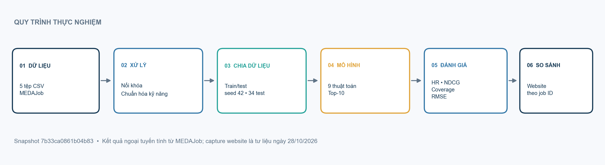

**Hình 1.** Quy trình thực nghiệm gồm chuẩn hóa dữ liệu, chia tập, tính gợi ý, đánh giá và đối chiếu mã việc làm. Ảnh website được ghi nhận ngày 28/10/2026.

## 2. Chức năng [Hồ sơ]

Hồ sơ ứng viên cung cấp kỹ năng cho thuật toán CBF. Trường `user_skills` có thể lưu dưới dạng danh sách JSON hoặc chuỗi, trong đó các kỹ năng được phân tách bằng dấu phẩy. Em chuẩn hóa Unicode NFC, chuyển chữ thường, xóa khoảng trắng thừa và loại bỏ các giá trị trùng nhau. Ví dụ, `python, fastapi, sql, data engineering` được chuyển thành bốn kỹ năng. Các cụm từ như `data engineering` được giữ nguyên và không tự đổi thành `data_engineering`. Trong bài này, CBF chỉ sử dụng trường kỹ năng.

Theo lần truy cập website ngày 28/10/2026, tài khoản sinh viên `sv102230343` có mã người dùng 458 nhưng chưa có hồ sơ ứng viên và chưa khai báo kỹ năng. Tài khoản này cũng không xuất hiện trong `users.csv` của MEDAJob nên em không tính được gợi ý ngoại tuyến riêng cho tài khoản. Hồ sơ ứng viên chưa được cập nhật trên website.

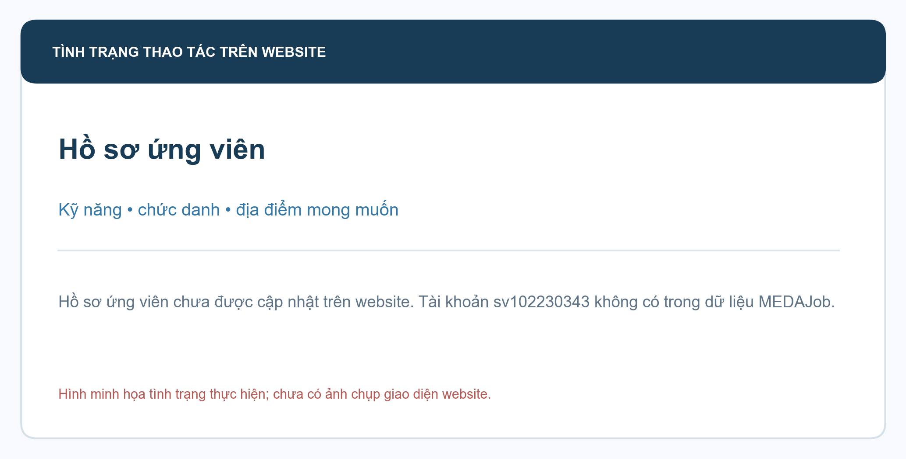

**Hình 2.** Thông tin hồ sơ ứng viên cần được bổ sung trước khi đánh giá gợi ý cá nhân. Hồ sơ trên website chưa được cập nhật.

## 3. Chức năng [Nhà tuyển dụng]

Chức năng Nhà tuyển dụng cho phép tìm kiếm, rà soát và nhập tin tuyển dụng bằng tệp CSV. Trong bộ dữ liệu, `jobs.csv` có 791 tin: 741 tin mang nhãn `career.vn` và 50 tin mang nhãn `test`. Có 790 tin trạng thái `open` và một tin `closed`. Trạng thái này phản ánh dữ liệu tại thời điểm tạo snapshot, không xác nhận tin còn tuyển ở thời điểm viết báo cáo.

Em đã chuẩn bị tệp CSV gồm 10 tin theo mẫu nhập dữ liệu, trong đó có mô tả, tên công ty và liên kết nguồn. Các tin chưa được nhập lên website. Trước khi đăng, cần kiểm tra lại tình trạng tuyển dụng và tin trùng lặp.

| Mã | Công ty | Tên tin rút gọn | Trạng thái |
|---|---|---|---|
| J01 | Bosch Global Software Technologies | Embedded Software Engineer – BSW | Chưa nhập |
| J02 | Bosch Global Software Technologies | Senior Embedded Software Engineer | Chưa nhập |
| J03 | Bosch Vietnam | IT Support Intern | Chưa nhập; cần xác minh loại hình |
| J04 | Bosch Global Software Technologies | Intern for Embedded Software | Chưa nhập |
| J05 | Bosch Global Software Technologies | Fresher Embedded Software Engineer | Chưa nhập |
| J06 | Bosch Global Software Technologies | Embedded Firmware Engineer | Chưa nhập |
| J07 | KMS Technology | Fresher Test Engineer | Chưa nhập |
| J08 | KMS Technology | Senior Full-stack Software Engineer | Chưa nhập |
| J09 | KMS Technology | Full-stack Test Engineer – Đà Nẵng | Chưa nhập |
| J10 | KMS Technology | Senior Test Engineer | Chưa nhập |

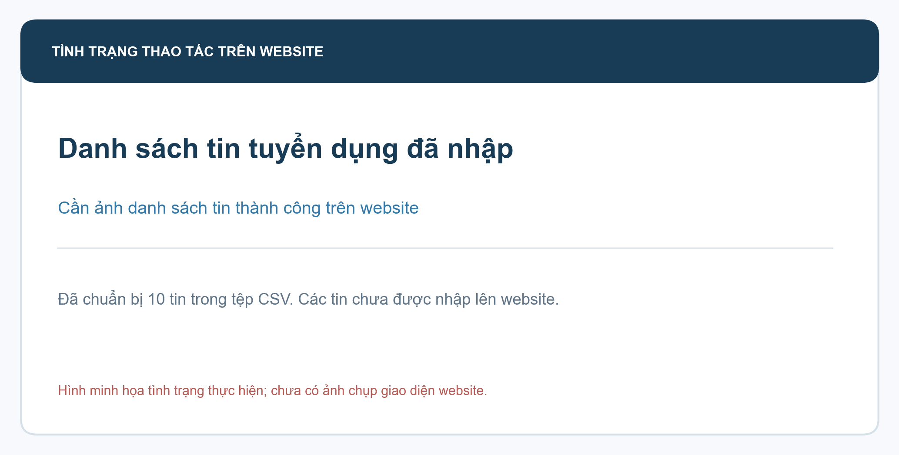

**Hình 3.** Danh sách tin tuyển dụng đã chuẩn bị. Các tin chưa được nhập lên website.

## 4. Chức năng [Tìm việc]

Chức năng Tìm việc hỗ trợ truy vấn theo từ khóa, công ty, địa điểm và loại hình. Khi tìm từ khóa `python` ngày 28/10/2026, website hiển thị 53 kết quả. Con số này phản ánh kết quả tìm kiếm tại thời điểm truy cập; trong MEDAJob có 791 tin. Hồ sơ sinh viên chưa có kỹ năng, nghề nghiệp và địa điểm mong muốn nên em chưa đánh giá mức độ phù hợp của danh sách với cá nhân.

Rating là đánh giá tường minh theo thang điểm 1–5. MEDAJob có 104 rating của 34 ứng viên. Các rating này thuộc dữ liệu cung cấp; em chưa đánh giá tin tuyển dụng theo sở thích cá nhân trên website.

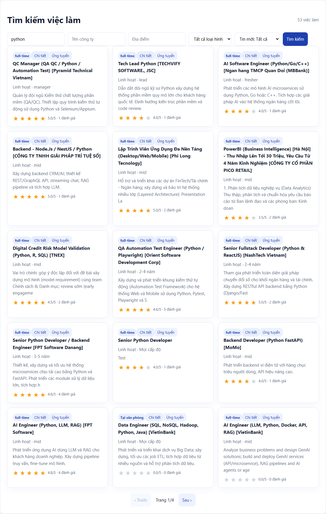

**Hình 4.** Kết quả tìm kiếm việc làm theo từ khóa `python`; website hiển thị 53 kết quả vào ngày 28/10/2026.

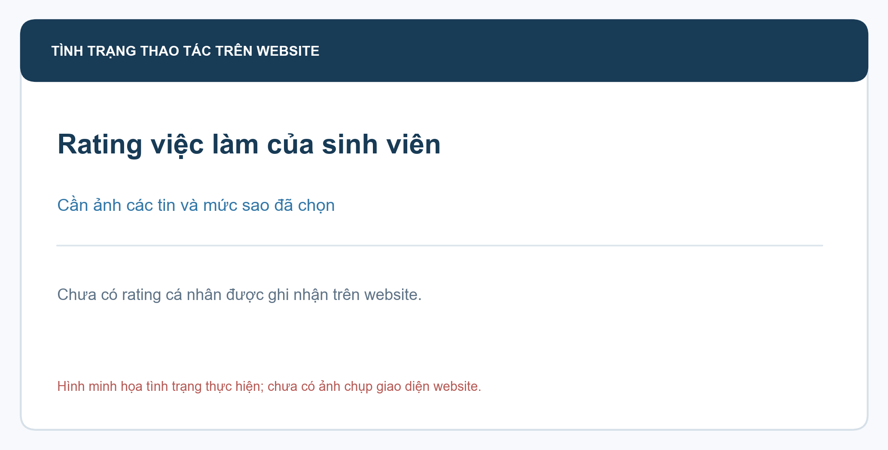

**Hình 5.** Minh họa phần đánh giá việc làm. Rating cá nhân trên website chưa được thực hiện.

## 5. Chức năng [Tìm việc]/[Gợi ý việc làm]

Ngày 31/10/2026, em đăng nhập tài khoản ứng viên `sv102230347`, chọn từng thuật toán và bấm **Gợi ý tìm việc**. CBF, Hybrid và Popularity hiển thị 10 tin; CF, User-KNN, Item-KNN, SGD, ALS Explicit và ALS Implicit báo “Chưa đủ dữ liệu gợi ý”. CBF Pearson vẫn hiển thị danh sách nhưng các điểm phù hợp là số âm. Các phần trăm trong ảnh là điểm giao diện trả về, không phải xác suất ứng tuyển thành công.

| Cấu hình | Kết quả ngày 31/10/2026 | Ghi nhận |
|---|---|---|
| CBF – Cosine | 10 tin | Điểm đầu danh sách: 34% |
| CBF – Jaccard | 10 tin | Điểm đầu danh sách: 21% |
| CBF – Pearson | 10 tin | Điểm đầu danh sách: -66%; giao diện có các điểm âm |
| CF – Cosine | Chưa đủ dữ liệu gợi ý | Danh sách không hiển thị |
| Hybrid – Cosine | 10 tin | — |
| User-KNN – Cosine | Chưa đủ dữ liệu gợi ý | Danh sách không hiển thị |
| Item-KNN – Cosine | Chưa đủ dữ liệu gợi ý | Danh sách không hiển thị |
| Popularity – Cosine | 10 tin | Tin được gắn nhãn “Được nhiều ứng viên quan tâm” |
| SGD – Cosine | Chưa đủ dữ liệu gợi ý | Danh sách không hiển thị |
| ALS Explicit – Cosine | Chưa đủ dữ liệu gợi ý | Danh sách không hiển thị |
| ALS Implicit – Cosine | Chưa đủ dữ liệu gợi ý | Danh sách không hiển thị |

Tài khoản `sv102230347` không có trong `users.csv` của snapshot MEDAJob. Vì vậy, em dùng ảnh này để ghi nhận giao diện website; em không đối sánh trực tiếp thứ hạng với kết quả tính ngoại tuyến.

**Hình 6.** CBF với Cosine hiển thị 10 tin gợi ý.

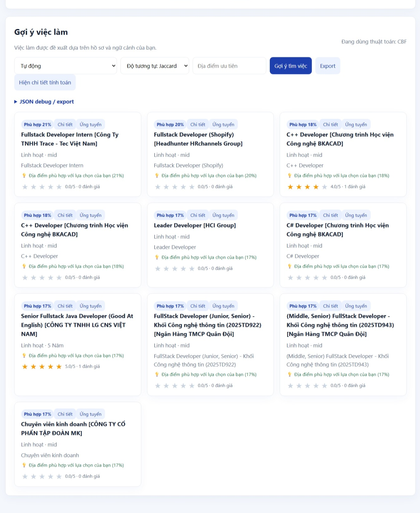

**Hình 7.** CBF với Jaccard hiển thị 10 tin gợi ý.

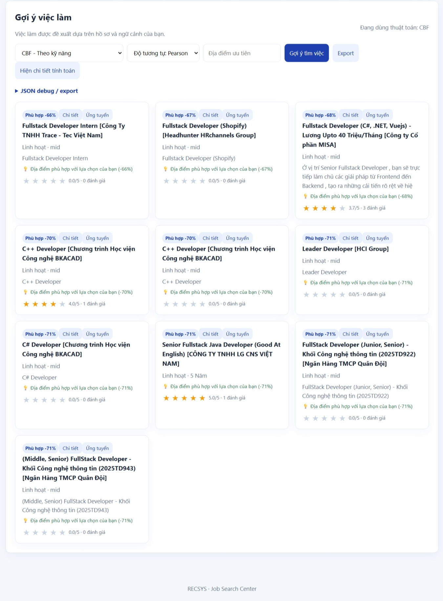

**Hình 8.** CBF với Pearson hiển thị các điểm phù hợp âm.

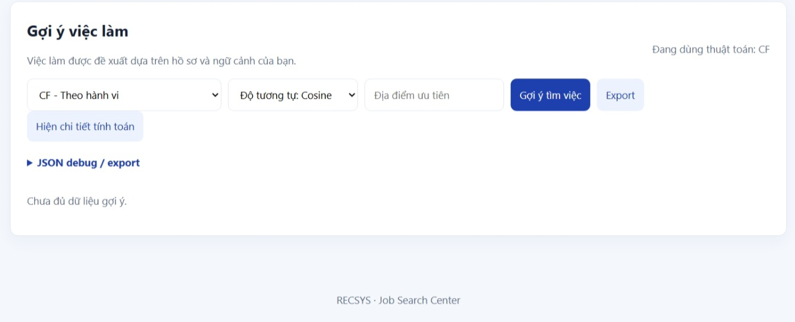

**Hình 9.** CF với Cosine báo chưa đủ dữ liệu gợi ý.

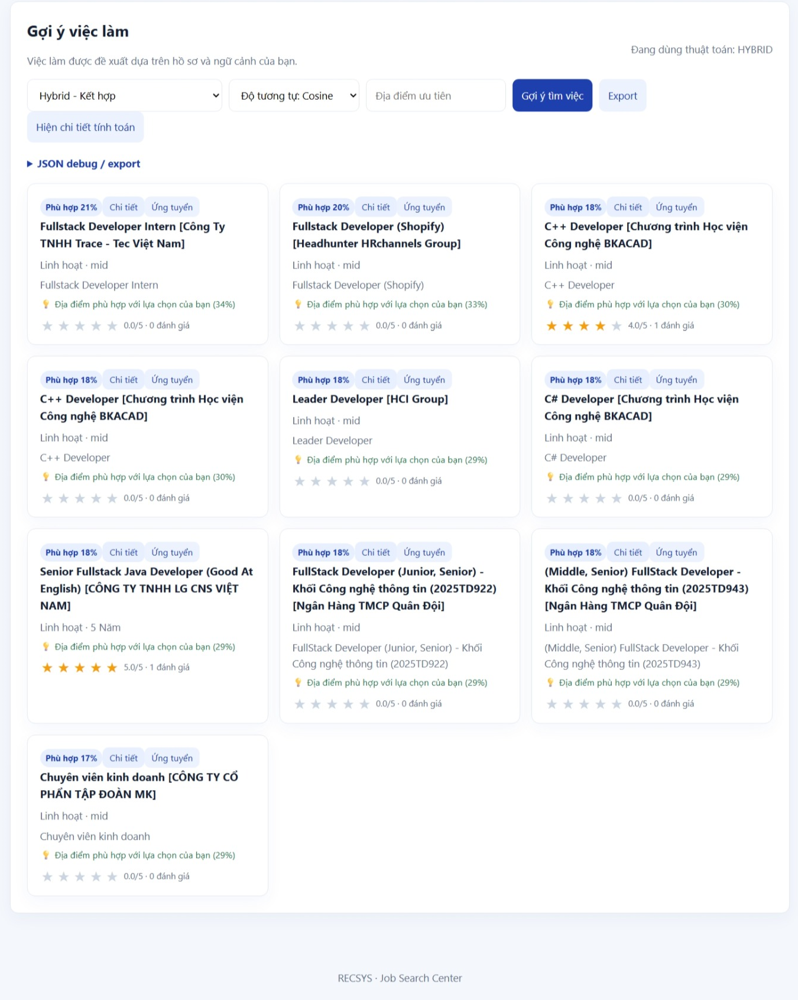

**Hình 10.** Hybrid với Cosine hiển thị 10 tin gợi ý.

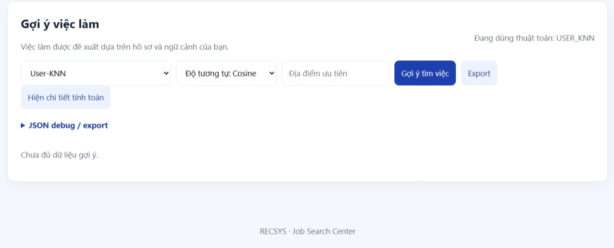

**Hình 11.** User-KNN với Cosine báo chưa đủ dữ liệu gợi ý.

**Hình 12.** Item-KNN với Cosine báo chưa đủ dữ liệu gợi ý.

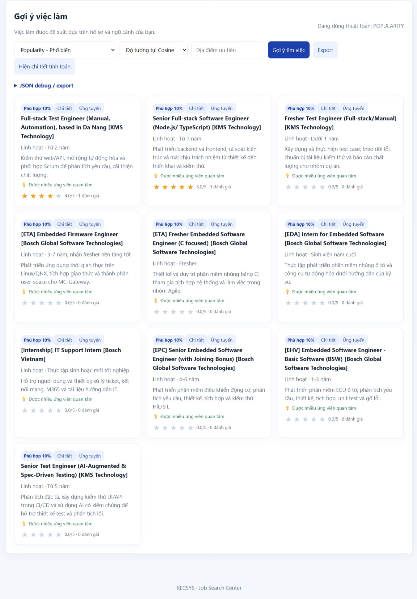

**Hình 13.** Popularity hiển thị 10 tin gợi ý.

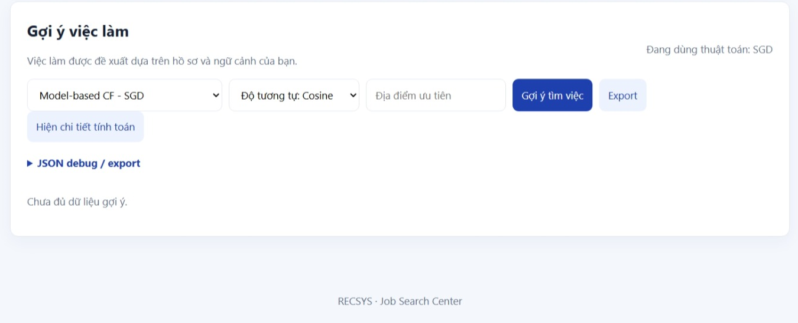

**Hình 14.** SGD báo chưa đủ dữ liệu gợi ý.

**Hình 15.** ALS Explicit báo chưa đủ dữ liệu gợi ý.

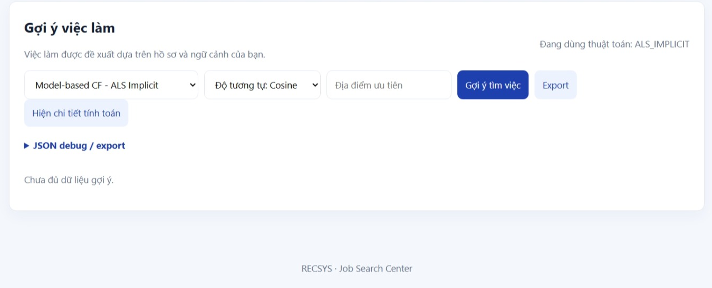

**Hình 16.** ALS Implicit báo chưa đủ dữ liệu gợi ý.
## 6. Tải bộ dữ liệu MEDAJob, lập trình tính toán và đối sánh kết quả

### 6.1. Dữ liệu, tiền xử lý và giao thức đánh giá

MEDAJob gồm năm tệp: `users.csv`, `user_profiles.csv`, `jobs.csv`, `ratings.csv` và `job_views.csv`. Các bảng được nối qua `user_id` và `job_id`. Snapshot sử dụng trong thí nghiệm có mã `7b33ca0861b04b83`; chương trình được chạy ngày 30/10/2026. Tài khoản `sv102230343` không có trong dữ liệu nên không tạo được danh sách gợi ý cá nhân từ snapshot này. Các chỉ số đánh giá dưới đây được tính trên 34 ứng viên có rating.

| Tệp | Số dòng | Vai trò trong thí nghiệm |
|---|---:|---|
| `users.csv` | 345 | 34 ứng viên và 311 nhà tuyển dụng |
| `user_profiles.csv` | 34 | Hồ sơ của 34 ứng viên; 311 tài khoản còn lại không có hồ sơ kỹ năng |
| `jobs.csv` | 791 | 790 tin `open`, 1 tin `closed`; 49 tin từng được rating |
| `ratings.csv` | 104 | Rating 3: 35; rating 4: 34; rating 5: 35 |
| `job_views.csv` | 680 | 680 cặp ứng viên–việc làm có lượt xem; thời điểm xem chỉ có một giá trị khác nhau |

Sau khi kiểm tra dữ liệu, em không phát hiện khóa ngoại sai, rating ngoài thang 1–5 hoặc cặp ứng viên–việc làm bị lặp trong bảng rating. Trường `job_vector` bị thiếu ở cả 791 tin nên em tạo vector kỹ năng từ `job_skills`. Kỹ năng trong dữ liệu có 13 dạng chuỗi khác nhau; chương trình đọc cả JSON và chuỗi phân tách, đồng thời chuẩn hóa chữ thường, Unicode và khoảng trắng. Các cách viết khác nhau không được tự động xem là cùng một kỹ năng. Rating không có thời điểm ghi nhận đáng tin cậy, còn lượt xem chỉ có một giá trị thời gian; vì vậy em không chia tập theo thời gian.

Ma trận rating của 34 ứng viên và 791 tin có 26.894 ô, trong đó chỉ 104 ô đã được đánh giá. Độ thưa là `1 − 104/(34×791) = 99,6133%`. Nếu tính cả 311 tài khoản nhà tuyển dụng, độ thưa là 99,9619%; tuy nhiên, cách tính này không phản ánh tập ứng viên của hệ gợi ý. Trong 104 rating, 103 thuộc 50 tin nhãn `test` và một rating thuộc 741 tin nhãn `career.vn`. Vì vậy, phần lớn danh mục chưa có tương tác và các chỉ số đánh giá không đại diện cho chất lượng tuyển dụng trên toàn thị trường.

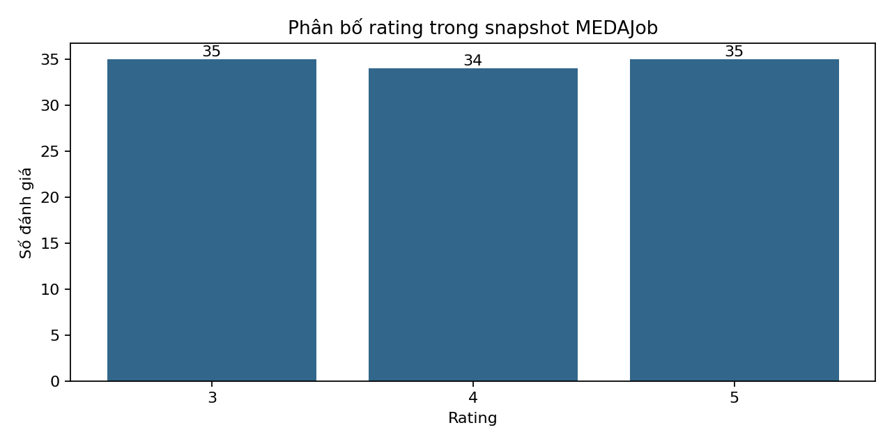

**Hình 17.** Biểu đồ cột rating 3, 4, 5 lần lượt có 35, 34, 35 quan sát; trục X là điểm rating, trục Y là số lượt đánh giá. Không có rating 1 hoặc 2 trong snapshot, dù thang website cho phép 1–5.

Hình dưới trình bày riêng số việc làm và số rating theo nhãn nguồn. Số liệu được tính bằng cách nối `jobs.csv` với `ratings.csv` theo mã việc làm.

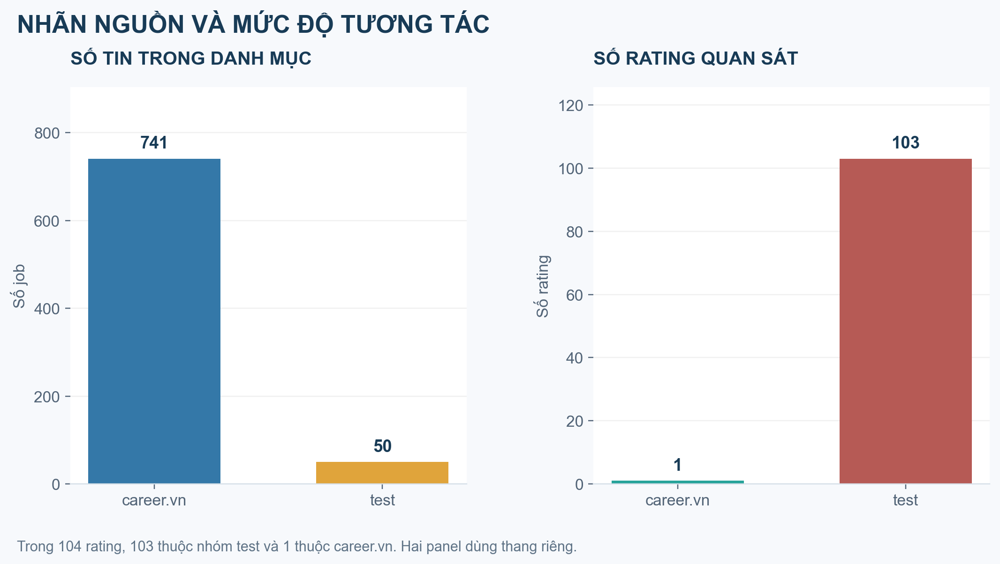

**Hình 18.** Số việc làm và số rating theo nhãn nguồn. Có 103 rating thuộc nhóm test và phần lớn việc làm mang nhãn career.vn.

Ma trận hành vi B được tạo từ rating và lượt xem: rating từ 4 trở lên được chuyển thành `B = rating/5`; lượt xem dương của cặp chưa được đánh giá có trọng số `0,25`; rating thấp không được xem là tín hiệu yêu thích. Khi tạo gợi ý, các tin người dùng đã đánh giá và tin không ở trạng thái `open` bị loại. Nếu mô hình thiếu tín hiệu, hệ thống dùng giá trị dự phòng (fallback) và xếp các tin này sau những tin có điểm từ mô hình. Khi điểm bằng nhau, thứ tự được xác định theo mã việc làm.

Khi đánh giá ngoại tuyến, em giữ lại ngẫu nhiên một rating từ 4 trở lên của mỗi ứng viên có ít nhất ba rating. Việc làm được giữ lại phải đang mở và còn rating khác trong tập huấn luyện. Với seed 42, tập train có 70 rating và tập test có 34 rating, mỗi ứng viên có một tin liên quan trong test. Mười chín lượt xem thuộc các cặp test cũng bị loại khỏi train. Đây là phép chia ngẫu nhiên, không phản ánh thứ tự tương tác theo thời gian.

`HitRate@K` là tỷ lệ ứng viên có tin trong tập kiểm tra xuất hiện trong Top-K. Trong thí nghiệm này, `Recall@K` bằng HitRate vì mỗi ứng viên chỉ có một tin kiểm tra. `NDCG@K` đánh giá thứ hạng của tin liên quan, trong đó vị trí cao được tính điểm lớn hơn. Độ bao phủ danh mục là tỷ lệ số tin khác nhau được gợi ý trên tổng số 790 tin đang mở. Tỷ lệ fallback cho biết phần gợi ý dùng giá trị dự phòng. RMSE và MAE được tính cho các mô hình dự đoán rating trên 34 rating tích cực trong tập kiểm tra.

### 6.2. CBF – Theo kỹ năng

CBF biểu diễn kỹ năng của ứng viên và việc làm thành vector nhị phân trên tập gồm 34 kỹ năng. Độ tương tự Cosine được tính theo công thức `sim(u,j) = (x_u · x_j)/(|x_u||x_j|)`. Jaccard lấy số kỹ năng chung chia cho số kỹ năng khác nhau trong hai danh sách. Pearson được tính sau khi trừ trung bình của từng vector. Ví dụ, ứng viên 3 có `data engineering`, `fastapi`, `python`, `sql`; việc làm 1 có `fastapi`, `python`, `rest`, `sqlalchemy`. Hai kỹ năng chung cho Cosine bằng 0,5000, Jaccard bằng 0,3333 và Pearson khoảng 0,4333. Đây là điểm tương tự kỹ năng trên thang riêng của thuật toán.

Khi hồ sơ thiếu kỹ năng, chương trình dùng điểm phổ biến làm giá trị dự phòng. Trên tập kiểm tra gồm 34 ứng viên, CBF đạt HR@10 = 0,1765 (6/34), NDCG@10 = 0,1098 và độ bao phủ 0,1063 (84/790 việc làm). Ảnh website ngày 31/10 trên tài khoản `sv102230347` cho thấy CBF hiển thị 10 tin với cả ba độ đo; Pearson trả điểm âm (Hình 6–8). Tài khoản này không có trong snapshot MEDAJob nên em không đối sánh trực tiếp hai danh sách.

### 6.3. CF – Theo hành vi

CF tính Cosine giữa các cột việc làm trong ma trận B, bỏ độ tương tự của một việc làm với chính nó, rồi cộng điểm từ những việc làm mà ứng viên đã tương tác tích cực. Điểm biểu thị mức độ tương đồng hành vi. Trên tập kiểm tra, CF đạt HR@10 = 0,3824 (13/34), NDCG@10 = 0,1809 và độ bao phủ 0,0494 (39/790 việc làm). Ở lần chụp ngày 31/10, website báo chưa đủ dữ liệu gợi ý cho CF (Hình 9). Tài khoản đăng nhập không có trong CSV MEDAJob nên em không đối sánh trực tiếp hai danh sách.

### 6.4. Hybrid – Kết hợp

Hybrid kết hợp điểm CBF và CF theo công thức `0,55 × minmax(CBF) + 0,45 × minmax(CF)`. Hai điểm được chuẩn hóa trước khi cộng vì có thang đo khác nhau. Khi một nhánh không có dữ liệu hỗ trợ, chương trình dùng nhánh còn lại; nếu cả hai nhánh đều thiếu dữ liệu thì dùng điểm phổ biến. Trên tập kiểm tra gồm 34 ứng viên, Hybrid đạt HR@10 = 0,2941 (10/34), NDCG@10 = 0,1371 và độ bao phủ 0,0810 (64/790 việc làm). Kết quả HitRate nằm giữa CBF và CF trong lần chia dữ liệu này. Ngày 31/10, website hiển thị 10 tin Hybrid cho tài khoản `sv102230347` (Hình 10); trọng số kết hợp trên website chưa xác định.

### 6.5. User-KNN

User-KNN chọn tối đa năm ứng viên có rating gần nhất theo độ tương tự Cosine. Rating dự đoán cho một việc làm là trung bình có trọng số từ những ứng viên đã đánh giá việc làm đó. Các ô chưa có rating không được xem là rating bằng 0. Nếu không có láng giềng phù hợp, mô hình dùng điểm phổ biến làm giá trị dự phòng. Trên tập kiểm tra, HR@10 = 0,3824, NDCG@10 = 0,3192, RMSE = 1,1843 và MAE = 1,0749. Tuy nhiên, 86,76% dòng trong Top-10 là kết quả dự phòng. Vì vậy, HitRate cao cần được xem cùng tỷ lệ dự phòng. Ảnh website ngày 31/10 báo chưa đủ dữ liệu cho User-KNN (Hình 11).

### 6.6. Item-KNN

Item-KNN tính Cosine giữa các cột rating của việc làm, chọn tối đa năm việc làm gần nhất và dự đoán rating bằng các việc làm tương tự mà ứng viên đã đánh giá. Trên tập kiểm tra, HR@10 = 0,3824, NDCG@10 = 0,3192, RMSE = 1,1465 và MAE = 1,0455. Tỷ lệ kết quả dự phòng cũng là 86,76%. RMSE của Item-KNN thấp hơn User-KNN trong lần chia này, nhưng cả hai mô hình vẫn phụ thuộc nhiều vào điểm phổ biến. Ảnh website ngày 31/10 báo chưa đủ dữ liệu cho Item-KNN (Hình 12).

### 6.7. Popularity – Phổ biến

Thuật toán Popularity trong chương trình dùng trung bình Bayes: `score(j) = (Σ rating_j + 5μ)/(n_j + 5)`, trong đó μ là rating trung bình của tập huấn luyện và `n_j` là số rating của việc làm j. Hệ số prior bằng 5 giúp hạn chế ảnh hưởng của những việc làm chỉ có một rating. Điểm phổ biến được tính từ rating, không phải số lượt xem. Trên tập kiểm tra, HR@10 = 0,1176 (4/34), NDCG@10 = 0,0426, độ bao phủ 0,0152 (12/790), RMSE = 1,0931 và MAE = 0,9671. Website ngày 31/10 hiển thị 10 tin Popularity và gắn nhãn được nhiều ứng viên quan tâm (Hình 13); công thức tính điểm trên website chưa rõ.

### 6.8. Model-based CF – SGD

SGD ước lượng rating theo công thức `μ + b_u + b_j + p_u · q_j`, với 12 nhân tố, 45 epoch, learning rate 0,012 và regularization 0,04. Khi chưa có rating cho ứng viên hoặc việc làm, mô hình dùng điểm phổ biến. Trên tập kiểm tra, SGD đạt HR@10 = 0,1176, NDCG@10 = 0,0364, RMSE = 1,2401 và MAE = 1,0720. Các chỉ số này thấp hơn kết quả của thuật toán Popularity về sai số rating; đường loss theo epoch chỉ thể hiện mức sai số trên tập huấn luyện. Website ngày 31/10 báo chưa đủ dữ liệu cho SGD (Hình 14).

### 6.9. Model-based CF – ALS Explicit

ALS Explicit trừ rating trung bình μ khỏi các rating quan sát, sau đó luân phiên cập nhật vector người dùng và việc làm bằng bình phương tối thiểu có regularization. Khi dự đoán, mô hình cộng lại μ. Thí nghiệm dùng 12 nhân tố, 12 vòng lặp và regularization 0,4. Trên tập kiểm tra, HR@10 = 0,2647 (9/34), NDCG@10 = 0,1675, độ bao phủ 0,0595 (47/790), RMSE = 1,1138 và MAE = 1,0194. Website ngày 31/10 báo chưa đủ dữ liệu cho ALS Explicit (Hình 15).

### 6.10. Model-based CF – ALS Implicit

ALS Implicit dùng preference `P = 1[B > 0]` và confidence `C = 1 + 16B`, với 12 nhân tố, 10 vòng lặp và regularization 0,7. Mô hình học mức độ ưu tiên từ rating cao và lượt xem, không dự đoán rating trên thang 1–5 nên không tính RMSE và MAE. Trong lần chia dữ liệu này, HR@10 = 0/34, NDCG@10 = 0 và độ bao phủ là 0,0620 (49/790). Mô hình vẫn tạo danh sách, nhưng không có tin test liên quan nào nằm trong Top-10. Website ngày 31/10 báo chưa đủ dữ liệu cho ALS Implicit (Hình 16).

### 6.11. Tổng hợp, biểu đồ và đối sánh website

| Thuật toán | HitRate/Recall@10 | NDCG@10 | Độ bao phủ | Tỷ lệ dự phòng Top-10 | RMSE trên tập kiểm tra |
|---|---:|---:|---:|---:|---:|
| CBF | 0,1765 | 0,1098 | 0,1063 | 0,0000 | Không áp dụng |
| CF | 0,3824 | 0,1809 | 0,0494 | 0,0000 | Không áp dụng |
| Hybrid | 0,2941 | 0,1371 | 0,0810 | 0,0000 | Không áp dụng |
| User-KNN | 0,3824 | 0,3192 | 0,0532 | 0,8676 | 1,1843 |
| Item-KNN | 0,3824 | 0,3192 | 0,0532 | 0,8676 | 1,1465 |
| Popularity | 0,1176 | 0,0426 | 0,0152 | 0,0000 | 1,0931 |
| SGD | 0,1176 | 0,0364 | 0,0266 | 0,0000 | 1,2401 |
| ALS Explicit | 0,2647 | 0,1675 | 0,0595 | 0,0000 | 1,1138 |
| ALS Implicit | 0,0000 | 0,0000 | 0,0620 | 0,0000 | Không áp dụng |

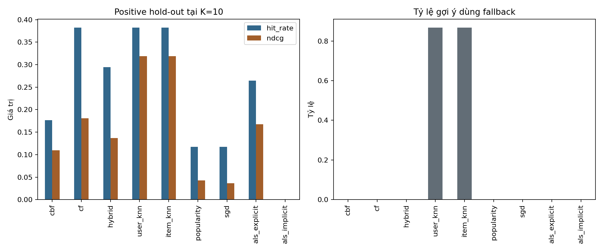

**Hình 19.** Biểu đồ bên trái thể hiện HitRate@10 và NDCG@10 của 34 ứng viên trong tập kiểm tra; biểu đồ bên phải thể hiện tỷ lệ việc làm dùng giá trị dự phòng. User-KNN và Item-KNN có HitRate cao nhưng phần lớn danh sách dựa trên điểm phổ biến.

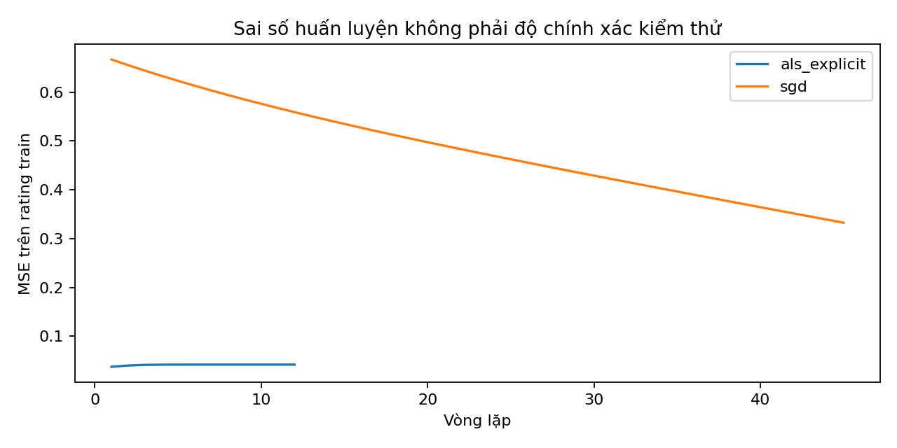

**Hình 20.** MSE trên rating của tập huấn luyện theo epoch đối với SGD và ALS Explicit. Đường giảm thể hiện mô hình khớp dần với dữ liệu huấn luyện; kết quả này được xem riêng với RMSE trên tập kiểm tra. ALS Implicit tối ưu hàm mục tiêu khác nên không biểu diễn trong hình.

Để so sánh chính xác danh sách Top-K giữa website và chương trình Python, cần dùng cùng tài khoản, cùng snapshot, cùng tập việc làm và cùng cấu hình thuật toán. Ảnh ngày 31/10 được ghi trên tài khoản `sv102230347`, tài khoản này không có trong snapshot MEDAJob nên em không đối sánh trực tiếp thứ hạng Top-K. Trang tìm việc trên website hiển thị 1.190 việc làm; MEDAJob có 790 việc làm đang mở, nên danh mục của hai hệ thống khác nhau.

Kết quả cho thấy dữ liệu tương tác thưa và rating tập trung chủ yếu ở các việc làm nhãn `test`. CBF dựa trên kỹ năng, CF và KNN dựa trên lịch sử tương tác, còn Hybrid kết hợp hai loại tín hiệu. Trong lần chia dữ liệu này, CF và hai thuật toán KNN đạt HitRate@10 cao nhất; tuy nhiên, hơn 86% gợi ý của User-KNN và Item-KNN dùng điểm dự phòng. ALS Implicit không tìm được tin kiểm tra liên quan trong Top-10. Do chưa có dữ liệu tuyển dụng thành công, thời điểm rating đáng tin cậy và tập kiểm định riêng, kết quả chưa đủ để xác định thuật toán phù hợp nhất khi ứng tuyển. Cần bổ sung hồ sơ và tương tác thực tế rồi đánh giá lại trên snapshot mới.

## 7. Tham khảo

[1] Đề thực hành Hệ thống RECSYS gợi ý việc làm, tài liệu học phần, các mục 1–7.

[2] Nguyễn Hoàng Hà và Nguyễn Duy Hoàng, “Thực hành Hệ hỗ trợ ra quyết định: Bộ dữ liệu MEDAJob,” báo cáo Lab02, nhóm học phần 22Nh15.

[3] MEDAJob, bộ dữ liệu gồm `users.csv`, `user_profiles.csv`, `jobs.csv`, `ratings.csv` và `job_views.csv`; dữ liệu được cập nhật trong tháng 10/2026. Snapshot dùng trong thí nghiệm có mã `7b33ca0861b04b83`.

[4] Chương trình Python thực hiện đọc dữ liệu, cài đặt mô hình và đánh giá, cùng cấu hình thí nghiệm seed 42.

[5] Y. Hu, Y. Koren, and C. Volinsky, “Collaborative Filtering for Implicit Feedback Datasets,” 2008, <https://yifanhu.net/PUB/cf.pdf>.

[6] Y. Koren, R. Bell, and C. Volinsky, “Matrix Factorization Techniques for Recommender Systems,” *Computer*, 42(8), 30–37, 2009, <https://doi.org/10.1109/MC.2009.263>.

[7] Ảnh chụp giao diện website RECSYS dùng trong mục 5, ngày truy cập 31/10/2026.
