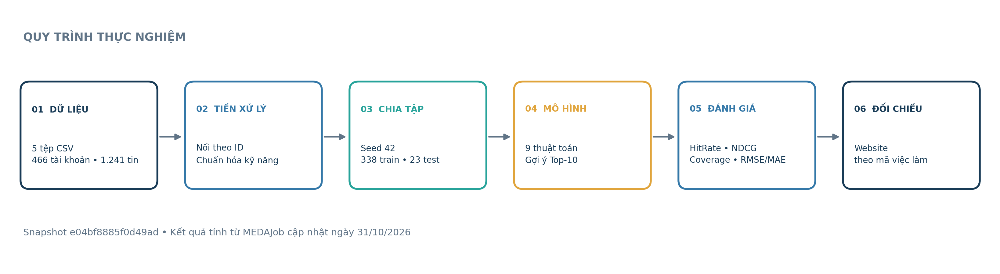
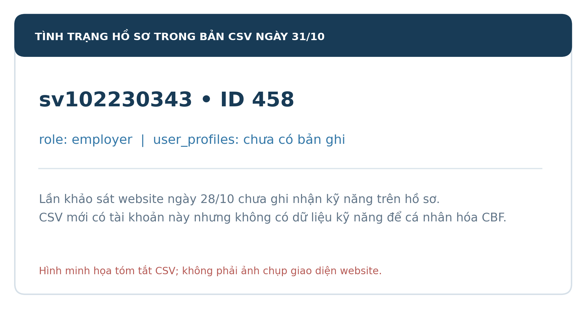
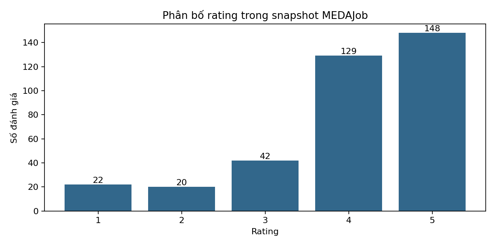
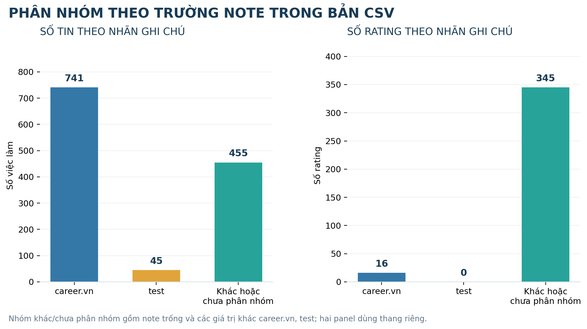
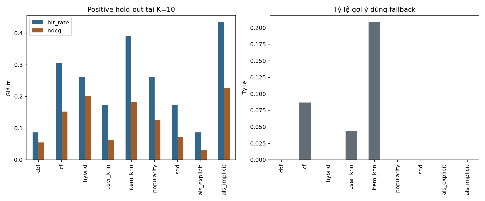
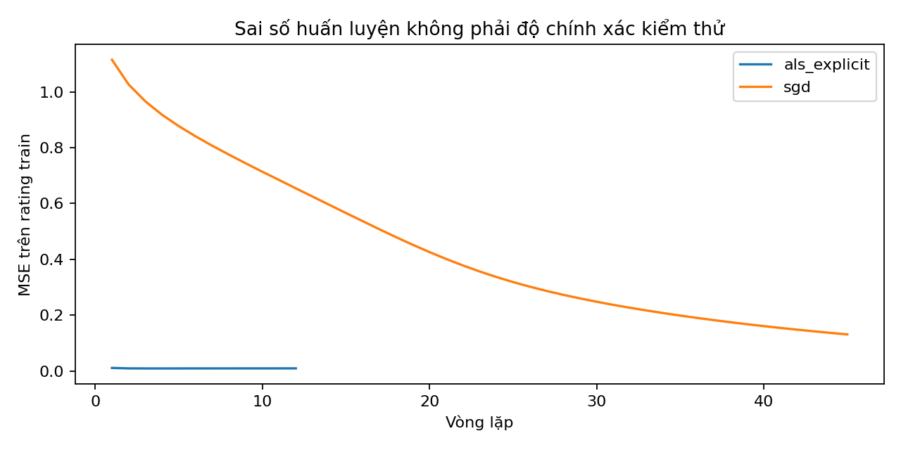

# HỆ THỐNG RECSYS GỢI Ý VIỆC LÀM

**Báo cáo thực hành Hệ hỗ trợ ra quyết định – Website RECSYS và bộ dữ liệu MEDAJob**  
**Sinh viên:** Nguyễn Hoàng Hà – MSSV 102230343  
**Nhóm học phần:** 22Nh15  
**Ngày xử lý dữ liệu:** 31/10/2026

Trong bài thực hành, em khảo sát các chức năng của website RECSYS và cài đặt chín thuật toán gợi ý bằng Python trên dữ liệu MEDAJob. Kết quả ngoại tuyến được cập nhật ngày 31/10/2026 bằng bộ CSV mới nhất. Ảnh website gồm lần ghi nhận ngày 28/10/2026 trên tài khoản `sv102230343` và phần bổ sung ngày 31/10/2026 trên tài khoản `sv102230347`; hai lần chụp được trình bày riêng vì khác tài khoản và thời điểm. Trong lần khảo sát ngày 28/10, em chưa cập nhật hồ sơ, đánh giá việc làm hoặc nhập tin tuyển dụng trên tài khoản `sv102230343`.

## Mục lục

1. Giới thiệu
2. Chức năng Hồ sơ
3. Chức năng Nhà tuyển dụng
4. Chức năng Tìm việc
5. Chức năng Gợi ý việc làm trên website
   - Ghi nhận bổ sung ngày 31/10/2026
6. Tải MEDAJob, lập trình và đối sánh kết quả
   - 6.1. Dữ liệu, tiền xử lý và đánh giá
   - 6.2. CBF – Theo kỹ năng
   - 6.3. CF – Theo hành vi
   - 6.4. Hybrid – Kết hợp
   - 6.5. User-KNN
   - 6.6. Item-KNN
   - 6.7. Popularity – Phổ biến
   - 6.8. Model-based CF – SGD
   - 6.9. Model-based CF – ALS Explicit
   - 6.10. Model-based CF – ALS Implicit
   - 6.11. Tổng hợp và đối sánh website
7. Tham khảo

## 1. Giới thiệu

Website RECSYS hỗ trợ xem và tìm kiếm việc làm, quản lý hồ sơ ứng viên, đánh giá tin tuyển dụng và tạo danh sách gợi ý bằng nhiều thuật toán. Trong bài này, em khảo sát các chức năng trên, sử dụng dữ liệu MEDAJob để cài đặt chín thuật toán gợi ý và đánh giá kết quả theo mã việc làm. Các kết quả định lượng được tính trên cùng một snapshot dữ liệu, trình bày tại mục 6.

Em sử dụng chương trình Python để đọc và kiểm tra dữ liệu, huấn luyện mô hình, tạo gợi ý và tính các chỉ số đánh giá. Kết quả trên website được dùng để quan sát giao diện và đối chiếu thứ tự việc làm theo ID. Do không có thông tin về cách cài đặt bên trong website, chưa thể kết luận hai hệ thống dùng cùng công thức hoặc cùng tập dữ liệu ứng viên.

**Hình 1.** Quy trình thực nghiệm trên snapshot `e04bf8885f0d49ad`: 338 rating dùng để huấn luyện, 23 rating kiểm tra và chín thuật toán. Ảnh website được ghi nhận ngày 28/10 và 31/10/2026.

## 2. Chức năng [Hồ sơ]

Hồ sơ ứng viên cung cấp kỹ năng cho thuật toán CBF. Trường `user_skills` có thể lưu dưới dạng danh sách JSON hoặc chuỗi, trong đó các kỹ năng được phân tách bằng dấu phẩy. Em chuẩn hóa Unicode NFC, chuyển chữ thường, xóa khoảng trắng thừa và loại bỏ các giá trị trùng nhau. Ví dụ, `python, fastapi, sql, data engineering` được chuyển thành bốn kỹ năng. Các cụm từ như `data engineering` được giữ nguyên và không tự đổi thành `data_engineering`. Trong bài này, CBF chỉ sử dụng trường kỹ năng.

Theo lần truy cập website ngày 28/10/2026, tài khoản `sv102230343` chưa có hồ sơ ứng viên và chưa khai báo kỹ năng. Trong bộ CSV mới ngày 31/10, tài khoản này có mã 458 và trường `role` là `employer`, nhưng chưa có dòng tương ứng trong `user_profiles.csv` hoặc rating nào. Vì vậy em không có kỹ năng để tính gợi ý CBF theo hồ sơ cho tài khoản này. Hồ sơ trên website chưa được cập nhật trong lần chụp ngày 28/10.

**Hình 2.** Bản CSV mới có tài khoản `sv102230343` nhưng gán vai trò nhà tuyển dụng và không có hồ sơ kỹ năng. Hình này là bản tóm tắt dữ liệu, không phải ảnh chụp giao diện website.

## 3. Chức năng [Nhà tuyển dụng]

Chức năng Nhà tuyển dụng cho phép tìm kiếm, rà soát và nhập tin tuyển dụng bằng tệp CSV. Trong bản `job.csv` cập nhật ngày 31/10 có 1.241 tin: 741 tin có `note` đúng bằng `career.vn`, 45 tin có `note` đúng bằng `test`, còn 455 tin có nhãn khác hoặc để trống. Có 1.190 tin trạng thái `open` và 51 tin `closed`. Trạng thái này phản ánh dữ liệu trong bản xuất, không xác nhận tin còn tuyển tại thời điểm viết báo cáo.

Em đã chuẩn bị tệp CSV gồm 10 tin theo mẫu nhập dữ liệu, trong đó có mô tả, tên công ty và liên kết nguồn. Các tin chưa được nhập lên website. Trước khi đăng, cần kiểm tra lại tình trạng tuyển dụng và tin trùng lặp.

| Mã | Công ty | Tên tin rút gọn | Trạng thái |
|---|---|---|---|
| J01 | Bosch Global Software Technologies | Embedded Software Engineer – BSW | Chưa nhập |
| J02 | Bosch Global Software Technologies | Senior Embedded Software Engineer | Chưa nhập |
| J03 | Bosch Vietnam | IT Support Intern | Chưa nhập; cần xác minh loại hình |
| J04 | Bosch Global Software Technologies | Intern for Embedded Software | Chưa nhập |
| J05 | Bosch Global Software Technologies | Fresher Embedded Software Engineer | Chưa nhập |
| J06 | Bosch Global Software Technologies | Embedded Firmware Engineer | Chưa nhập |
| J07 | KMS Technology | Fresher Test Engineer | Chưa nhập |
| J08 | KMS Technology | Senior Full-stack Software Engineer | Chưa nhập |
| J09 | KMS Technology | Full-stack Test Engineer – Đà Nẵng | Chưa nhập |
| J10 | KMS Technology | Senior Test Engineer | Chưa nhập |

**Hình 3.** Danh sách tin tuyển dụng đã chuẩn bị. Các tin chưa được nhập lên website.

## 4. Chức năng [Tìm việc]

Chức năng Tìm việc hỗ trợ truy vấn theo từ khóa, công ty, địa điểm và loại hình. Khi tìm từ khóa `python` ngày 28/10/2026, website hiển thị 53 kết quả. Con số này phản ánh kết quả tìm kiếm tại thời điểm truy cập; bản MEDAJob cập nhật sau đó có 1.241 tin, trong đó 1.190 tin ghi trạng thái `open`. Hồ sơ `sv102230343` chưa có kỹ năng, nghề nghiệp và địa điểm mong muốn nên em chưa đánh giá mức độ phù hợp của danh sách với tài khoản này.

Rating là đánh giá tường minh theo thang điểm 1–5. Bản MEDAJob mới có 361 rating từ 26 tài khoản; trong đó 354 rating thuộc 25 tài khoản gán vai trò `employer`, còn 7 rating thuộc một tài khoản gán vai trò `candidate`. Vì vậy, số rating trong bản xuất không thể xem là dữ liệu đánh giá của riêng ứng viên. Em chưa đánh giá tin tuyển dụng theo sở thích cá nhân trên website trong lần chụp ngày 28/10.

**Hình 4.** Kết quả tìm kiếm việc làm theo từ khóa `python`; website hiển thị 53 kết quả vào ngày 28/10/2026.

**Hình 5.** Minh họa phần đánh giá việc làm. Rating cá nhân trên website chưa được thực hiện.

## 5. Chức năng [Tìm việc]/[Gợi ý việc làm]

Ngày 31/10/2026, em đăng nhập tài khoản ứng viên `sv102230347`, chọn từng thuật toán và bấm **Gợi ý tìm việc**. CBF, Hybrid và Popularity hiển thị 10 tin; CF, User-KNN, Item-KNN, SGD, ALS Explicit và ALS Implicit báo “Chưa đủ dữ liệu gợi ý”. CBF Pearson vẫn hiển thị danh sách nhưng các điểm phù hợp là số âm. Các phần trăm trong ảnh là điểm giao diện trả về, không phải xác suất ứng tuyển thành công.

| Cấu hình | Kết quả ngày 31/10/2026 | Ghi nhận |
|---|---|---|
| CBF – Cosine | 10 tin | Điểm đầu danh sách: 34% |
| CBF – Jaccard | 10 tin | Điểm đầu danh sách: 21% |
| CBF – Pearson | 10 tin | Điểm đầu danh sách: -66%; giao diện có các điểm âm |
| CF – Cosine | Chưa đủ dữ liệu gợi ý | Danh sách không hiển thị |
| Hybrid – Cosine | 10 tin | — |
| User-KNN – Cosine | Chưa đủ dữ liệu gợi ý | Danh sách không hiển thị |
| Item-KNN – Cosine | Chưa đủ dữ liệu gợi ý | Danh sách không hiển thị |
| Popularity – Cosine | 10 tin | Tin được gắn nhãn “Được nhiều ứng viên quan tâm” |
| SGD – Cosine | Chưa đủ dữ liệu gợi ý | Danh sách không hiển thị |
| ALS Explicit – Cosine | Chưa đủ dữ liệu gợi ý | Danh sách không hiển thị |
| ALS Implicit – Cosine | Chưa đủ dữ liệu gợi ý | Danh sách không hiển thị |

Trong bộ CSV ngày 31/10, `sv102230347` có ID 459, hồ sơ kỹ năng và 8 rating, nhưng trường `role` là `employer`. Em dùng ảnh để ghi nhận giao diện website; do khác biệt vai trò và ảnh không thể hiện mã đầy đủ của các tin, em không đối sánh trực tiếp thứ hạng với kết quả ngoại tuyến.

### Kiểm tra độ phù hợp với hồ sơ và rating

Hồ sơ ID 459 có kỹ năng `python`, `sql`, `springboot`, `fastapi`, nhưng danh sách CBF chủ yếu là tin Fullstack, C++ và C#, nên mức khớp chưa rõ. Popularity có đề xuất hai tin người dùng từng chấm 4/5 và 5/5, phù hợp với rating cũ nhưng không còn mới; CBF Pearson lại hiển thị điểm âm. Sáu thuật toán còn lại không có danh sách để đối chiếu. Nhận xét này có giới hạn vì CSV ghi ID 459 là `employer`, còn website được thao tác ở trang ứng viên.

**Hình 6.** CBF với Cosine hiển thị 10 tin gợi ý.

**Hình 7.** CBF với Jaccard hiển thị 10 tin gợi ý.

**Hình 8.** CBF với Pearson hiển thị các điểm phù hợp âm.

**Hình 9.** CF với Cosine báo chưa đủ dữ liệu gợi ý.

**Hình 10.** Hybrid với Cosine hiển thị 10 tin gợi ý.

**Hình 11.** User-KNN với Cosine báo chưa đủ dữ liệu gợi ý.

**Hình 12.** Item-KNN với Cosine báo chưa đủ dữ liệu gợi ý.

**Hình 13.** Popularity hiển thị 10 tin gợi ý.

**Hình 14.** SGD báo chưa đủ dữ liệu gợi ý.

**Hình 15.** ALS Explicit báo chưa đủ dữ liệu gợi ý.

**Hình 16.** ALS Implicit báo chưa đủ dữ liệu gợi ý.
## 6. Tải bộ dữ liệu MEDAJob, lập trình tính toán và đối sánh kết quả

### 6.1. Dữ liệu, tiền xử lý và giao thức đánh giá

Bộ MEDAJob em dùng lần này gồm `users.csv`, `user_profiles.csv`, `job.csv`, `ratings.csv` và `job_views.csv`; các bảng được nối theo `user_id` và `job_id`. Snapshot có mã `e04bf8885f0d49ad`, được xử lý ngày 31/10/2026. `sv102230347` có trong dữ liệu với ID 459, hồ sơ kỹ năng và 8 rating. Tuy nhiên, trường `role` của tài khoản này là `employer`, trong khi ảnh website ngày 31/10 ghi nhận thao tác ở trang gợi ý dành cho ứng viên.

| Tệp | Số dòng | Nội dung chính |
|---|---:|---|
| `users.csv` | 466 | 34 ứng viên, 431 nhà tuyển dụng và 1 tài khoản quản trị |
| `user_profiles.csv` | 78 | 73 hồ sơ có kỹ năng; cả 34 tài khoản gán vai trò ứng viên đều có kỹ năng |
| `job.csv` | 1.241 | 1.190 tin `open`, 51 tin `closed`; 741 note `career.vn`, 45 note `test`, 455 note khác hoặc trống |
| `ratings.csv` | 361 | 22 rating mức 1, 20 mức 2, 42 mức 3, 129 mức 4 và 148 mức 5 |
| `job_views.csv` | 0 | Bản xuất không có lượt xem |

Em không phát hiện ID trùng, khóa ngoại sai, cặp người dùng–việc làm bị lặp hoặc rating ngoài thang 1–5. Có 26 tài khoản gửi rating: 25 tài khoản có vai trò `employer` gửi 354 rating, còn 1 tài khoản `candidate` gửi 7 rating. Do đó, dữ liệu rating hiện tại chủ yếu phản ánh tài khoản nhà tuyển dụng, không đại diện tốt cho hành vi ứng viên. Tài khoản `sv102230347` có kỹ năng `python`, `sql`, `springboot`, `fastapi`; tài khoản `sv102230343` được gán vai trò `employer` nhưng không có hồ sơ kỹ năng hoặc rating.

Trường vector có sẵn trong tệp việc làm không được dùng; em tạo biểu diễn kỹ năng từ `job_skills`. Chương trình đọc kỹ năng dạng JSON hoặc chuỗi phân tách, chuẩn hóa Unicode, chữ thường và khoảng trắng, nhưng không tự gộp các cách viết khác nhau như `JS` và `JavaScript`. Rating không có thời điểm ghi nhận đáng tin cậy; tệp lượt xem rỗng nên không thể chia tập theo thời gian hoặc dùng tín hiệu lượt xem.

Ma trận gồm 466 tài khoản và 1.241 việc làm có 578.306 ô, trong đó có 361 rating; độ thưa là 99,9376%. Nếu chỉ xét 34 tài khoản ứng viên thì có 7 rating trên 42.194 ô, độ thưa là 99,9834%. Bản xuất có 1.190 tin `open`; khi đánh giá, chương trình chỉ xếp hạng các tin đang mở và loại việc làm người dùng đã rating.

**Hình 17.** Phân bố 361 rating theo thang 1–5: 22 rating mức 1, 20 mức 2, 42 mức 3, 129 mức 4 và 148 mức 5.

Biểu đồ dưới đây nhóm tin theo giá trị của trường `note`, đồng thời đếm rating gắn với từng nhóm qua `job_id`. Nhóm “khác hoặc chưa phân nhóm” gồm giá trị trống và các nội dung khác với hai nhãn `career.vn`, `test`.

**Hình 18.** Nhóm `career.vn` có 741 tin và 16 rating; nhóm `test` có 45 tin nhưng không có rating; nhóm khác hoặc chưa phân nhóm có 455 tin và 345 rating. Hai biểu đồ dùng thang riêng.

Ma trận hành vi B dùng rating từ 4 trở lên theo `B = rating/5`; rating thấp không được xem là tín hiệu yêu thích. Vì `job_views.csv` rỗng nên trong lần này không có trọng số lượt xem `0,25`. Khi tạo gợi ý, các tin đã được rating và tin không ở trạng thái `open` bị loại. Nếu mô hình không có tín hiệu hỗ trợ, chương trình dùng điểm dự phòng (fallback) và xếp các tin đó sau tin có điểm từ mô hình. Khi điểm bằng nhau, thứ tự được xác định theo mã việc làm.

Khi đánh giá ngoại tuyến, em giữ lại ngẫu nhiên một rating từ 4 trở lên của mỗi tài khoản đủ điều kiện có ít nhất ba rating. Tin được giữ lại phải đang mở và còn rating khác trong tập train. Với seed 42, tập train có 338 rating và tập test có 23 rating, mỗi tài khoản kiểm tra có một tin liên quan. Ba tài khoản bị loại do có dưới ba rating; trong 23 tài khoản kiểm tra có 1 ứng viên và 22 nhà tuyển dụng. Đây là phép chia ngẫu nhiên, không phản ánh thứ tự tương tác theo thời gian.

`HitRate@K` là tỷ lệ tài khoản có tin trong tập kiểm tra xuất hiện trong Top-K. `Recall@K` bằng HitRate vì mỗi tài khoản kiểm tra chỉ có một tin liên quan. `NDCG@K` tính điểm cao hơn cho tin liên quan được xếp ở vị trí cao. Độ bao phủ là tỷ lệ tin khác nhau được gợi ý trên 1.190 tin đang mở; tỷ lệ fallback cho biết phần gợi ý dùng điểm dự phòng. RMSE và MAE chỉ áp dụng cho năm thuật toán dự đoán rating, trên 23 rating tích cực được giữ lại. Vì 22/23 tài khoản kiểm tra có vai trò nhà tuyển dụng, các chỉ số này không nên được diễn giải như đánh giá đại diện cho ứng viên.

### 6.2. CBF – Theo kỹ năng

CBF biểu diễn kỹ năng người dùng và việc làm thành vector nhị phân. Điểm Cosine được tính theo `sim(u,j) = (x_u · x_j)/(|x_u||x_j|)`; chương trình cũng có thể tính Jaccard hoặc Pearson để quan sát độ tương tự. Ví dụ, hồ sơ ID 459 có `python`, `sql`, `springboot`, `fastapi`; tin Python Backend Developer ID 945 khớp `fastapi`, `python` và có Cosine 0,5774.

Khi hồ sơ không có kỹ năng, chương trình dùng điểm phổ biến làm dự phòng. Trên tập kiểm tra gồm 23 tài khoản, CBF đạt HitRate@10 = 0,0870 (2/23), NDCG@10 = 0,0549 và độ bao phủ 0,0882 (105/1.190 tin). Bản CSV có hồ sơ và 8 rating của ID 459, nhưng gán vai trò `employer`; vì vậy kết quả cá nhân hóa này không thể xem là kiểm tra trên một hồ sơ ứng viên đã được xác nhận. Ảnh website ngày 31/10 cho thấy CBF hiển thị 10 tin và Pearson có điểm âm (Hình 6–8).

### 6.3. CF – Theo hành vi

CF tính Cosine giữa các cột việc làm trong ma trận B, bỏ độ tương tự của một việc làm với chính nó, rồi cộng điểm từ những việc làm có tương tác tích cực. Trên 23 tài khoản kiểm tra, CF đạt HitRate@10 = 0,3043 (7/23), NDCG@10 = 0,1526, độ bao phủ 0,0756 (90/1.190 tin) và tỷ lệ fallback 0,0870. Ảnh website ngày 31/10 báo chưa đủ dữ liệu gợi ý cho CF (Hình 9).

### 6.4. Hybrid – Kết hợp

Hybrid kết hợp điểm CBF và CF theo công thức `0,55 × minmax(CBF) + 0,45 × minmax(CF)`. Hai điểm được chuẩn hóa trước khi cộng vì có thang đo khác nhau. Khi một nhánh không có dữ liệu hỗ trợ, chương trình dùng nhánh còn lại; nếu cả hai nhánh đều thiếu dữ liệu thì dùng điểm phổ biến. Trên tập kiểm tra, Hybrid đạt HitRate@10 = 0,2609 (6/23), NDCG@10 = 0,2021, độ bao phủ 0,0924 (110/1.190 tin) và không có fallback trong Top-10. Ngày 31/10, website hiển thị 10 tin Hybrid cho tài khoản `sv102230347` (Hình 10); trọng số kết hợp trên website chưa xác định.

### 6.5. User-KNN

User-KNN chọn tối đa năm tài khoản gần nhất theo độ tương tự Cosine. Rating dự đoán cho một việc làm là trung bình có trọng số từ các tài khoản đã đánh giá việc làm đó; ô chưa có rating không được xem là rating bằng 0. Trên tập kiểm tra, HitRate@10 = 0,1739 (4/23), NDCG@10 = 0,0625, RMSE = 1,1085 và MAE = 0,6932. Tỷ lệ fallback trong Top-10 là 0,0435. Ảnh website ngày 31/10 báo chưa đủ dữ liệu cho User-KNN (Hình 11).

### 6.6. Item-KNN

Item-KNN tính Cosine giữa các cột rating của việc làm, chọn tối đa năm việc làm gần nhất và dự đoán rating từ các việc làm tương tự mà người dùng đã đánh giá. Trên tập kiểm tra, HitRate@10 = 0,3913 (9/23), NDCG@10 = 0,1826, RMSE = 1,0308 và MAE = 0,8959. Tỷ lệ fallback trong Top-10 là 0,2087. RMSE thấp hơn User-KNN ở lần chia này, nhưng hơn một phần năm danh sách dùng điểm dự phòng. Ảnh website ngày 31/10 báo chưa đủ dữ liệu cho Item-KNN (Hình 12).

### 6.7. Popularity – Phổ biến

Thuật toán Popularity dùng trung bình Bayes: `score(j) = (Σ rating_j + 5μ)/(n_j + 5)`, trong đó μ là rating trung bình tập train và `n_j` là số rating của việc làm j. Trên tập kiểm tra, HitRate@10 = 0,2609 (6/23), NDCG@10 = 0,1263, độ bao phủ 0,0151 (18/1.190 tin), RMSE = 0,7606 và MAE = 0,6492. Đây là RMSE thấp nhất trong năm thuật toán dự đoán rating ở lần chia này. Điểm phổ biến được tính từ rating, không phải lượt xem. Website ngày 31/10 hiển thị 10 tin Popularity và gắn nhãn được nhiều ứng viên quan tâm (Hình 13); công thức điểm trên website chưa rõ.

### 6.8. Model-based CF – SGD

SGD ước lượng rating theo công thức `μ + b_u + b_j + p_u · q_j`, với 12 nhân tố, 45 epoch, learning rate 0,012 và regularization 0,04. Trên tập kiểm tra, SGD đạt HitRate@10 = 0,1739 (4/23), NDCG@10 = 0,0721, RMSE = 0,9458 và MAE = 0,6346. RMSE cao hơn Popularity, còn MAE thấp hơn một ít. Đường loss theo epoch chỉ thể hiện sai số trên dữ liệu train. Website ngày 31/10 báo chưa đủ dữ liệu cho SGD (Hình 14).

### 6.9. Model-based CF – ALS Explicit

ALS Explicit trừ rating trung bình μ khỏi rating quan sát, sau đó luân phiên cập nhật vector người dùng và việc làm bằng bình phương tối thiểu có regularization. Thí nghiệm dùng 12 nhân tố, 12 vòng lặp và regularization 0,4. Trên tập kiểm tra, HitRate@10 = 0,0870 (2/23), NDCG@10 = 0,0313, độ bao phủ 0,0765 (91/1.190 tin), RMSE = 0,8923 và MAE = 0,7084. Website ngày 31/10 báo chưa đủ dữ liệu cho ALS Explicit (Hình 15).

### 6.10. Model-based CF – ALS Implicit

ALS Implicit dùng preference `P = 1[B > 0]` và confidence `C = 1 + 16B`, với 12 nhân tố, 10 vòng lặp và regularization 0,7. Vì bản CSV không có lượt xem, tín hiệu B chỉ được tạo từ rating 4–5. Mô hình không dự đoán rating theo thang 1–5 nên RMSE và MAE không áp dụng. Trong lần chia này, HitRate@10 = 0,4348 (10/23), NDCG@10 = 0,2258 và độ bao phủ 0,0807 (96/1.190 tin). Đây là HitRate và NDCG cao nhất trong lần chia, nhưng phần lớn test đến từ tài khoản gán vai trò nhà tuyển dụng. Website ngày 31/10 báo chưa đủ dữ liệu cho ALS Implicit (Hình 16).

### 6.11. Tổng hợp, biểu đồ và đối sánh website

| Thuật toán | HitRate/Recall@10 | NDCG@10 | Độ bao phủ (tin) | Fallback Top-10 | RMSE | MAE |
|---|---:|---:|---:|---:|---:|---:|
| CBF | 0,0870 | 0,0549 | 105/1.190 (8,82%) | 0,0000 | — | — |
| CF | 0,3043 | 0,1526 | 90/1.190 (7,56%) | 0,0870 | — | — |
| Hybrid | 0,2609 | 0,2021 | 110/1.190 (9,24%) | 0,0000 | — | — |
| User-KNN | 0,1739 | 0,0625 | 64/1.190 (5,38%) | 0,0435 | 1,1085 | 0,6932 |
| Item-KNN | 0,3913 | 0,1826 | 71/1.190 (5,97%) | 0,2087 | 1,0308 | 0,8959 |
| Popularity | 0,2609 | 0,1263 | 18/1.190 (1,51%) | 0,0000 | 0,7606 | 0,6492 |
| SGD | 0,1739 | 0,0721 | 40/1.190 (3,36%) | 0,0000 | 0,9458 | 0,6346 |
| ALS Explicit | 0,0870 | 0,0313 | 91/1.190 (7,65%) | 0,0000 | 0,8923 | 0,7084 |
| ALS Implicit | 0,4348 | 0,2258 | 96/1.190 (8,07%) | 0,0000 | — | — |

Các chỉ số xếp hạng trong bảng được tính trên 23 rating kiểm tra; 22 tài khoản có vai trò `employer` và một tài khoản có vai trò `candidate`.

**Hình 19.** Biểu đồ trái thể hiện HitRate@10 và NDCG@10; biểu đồ phải thể hiện tỷ lệ gợi ý dùng fallback trong Top-10. ALS Implicit có HitRate cao nhất, còn Hybrid có NDCG cao thứ hai sau ALS Implicit.

**Hình 20.** MSE trên rating train theo epoch của SGD và ALS Explicit. Đường này mô tả mức khớp với tập train, không thay cho RMSE trên tập kiểm tra.

Trong bản CSV mới, tài khoản `sv102230347` có hồ sơ kỹ năng và 8 rating nên chương trình có thể tạo danh sách ngoại tuyến riêng. Tuy nhiên, CSV gán ID 459 vai trò `employer`, còn ảnh ngày 31/10 được chụp khi thao tác ở trang dành cho ứng viên. Ảnh không cung cấp đầy đủ ID việc làm để so khớp Top-K; vì vậy em chưa kết luận hai danh sách có cùng thứ hạng. Website hiển thị 1.190 việc làm, bằng số tin `open` trong CSV hiện tại, nhưng điều đó chưa chứng minh hai danh mục hoặc thời điểm dữ liệu trùng khớp.

Trong lần chia này, ALS Implicit đạt HitRate@10 cao nhất (10/23), tiếp theo là Item-KNN (9/23); ALS Implicit cũng có NDCG cao nhất. Popularity có RMSE thấp nhất, còn SGD có MAE thấp nhất trong năm mô hình dự đoán rating. Các kết quả này cần được đọc cùng độ thưa của dữ liệu và việc 354/361 rating đến từ tài khoản có vai trò nhà tuyển dụng. Vì rating không có thời gian, chỉ có 7 rating từ tài khoản ứng viên và chưa có dữ liệu ứng tuyển thành công, kết quả chưa đủ để chọn thuật toán phù hợp nhất cho người tìm việc. Cần kiểm tra lại vai trò tài khoản trong dữ liệu và bổ sung tương tác ứng viên trước khi đánh giá tiếp.

## 7. Tham khảo

[1] Đề thực hành Hệ thống RECSYS gợi ý việc làm, tài liệu học phần, các mục 1–7.

[2] Nguyễn Hoàng Hà và Nguyễn Duy Hoàng, “Thực hành Hệ hỗ trợ ra quyết định: Bộ dữ liệu MEDAJob,” báo cáo Lab02, nhóm học phần 22Nh15.

[3] MEDAJob, bộ CSV cập nhật ngày 31/10/2026 gồm `users.csv`, `user_profiles.csv`, `job.csv`, `ratings.csv` và `job_views.csv`. Snapshot dùng trong thí nghiệm có mã `e04bf8885f0d49ad`.

[4] Chương trình Python thực hiện đọc dữ liệu, cài đặt mô hình và đánh giá, cùng cấu hình thí nghiệm seed 42.

[5] Y. Hu, Y. Koren, and C. Volinsky, “Collaborative Filtering for Implicit Feedback Datasets,” 2008, <https://yifanhu.net/PUB/cf.pdf>.

[6] Y. Koren, R. Bell, and C. Volinsky, “Matrix Factorization Techniques for Recommender Systems,” *Computer*, 42(8), 30–37, 2009, <https://doi.org/10.1109/MC.2009.263>.

[7] Ảnh chụp giao diện website RECSYS dùng trong mục 5, ngày truy cập 31/10/2026.
